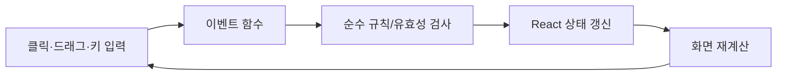

# Python 사용자를 위한 코드 가이드

마지막 갱신: 2026-11-03

이 문서는 Python 문법에는 익숙하지만 TypeScript·React는 처음인 사람이 현재 DTTS 코드를 읽고 안전하게 수정할 수 있도록 쓴 안내서다.

## 1. 프로그램의 기본 모양

Python 프로그램은 흔히 위에서 아래로 실행하거나 함수 호출을 기다린다. 이 게임의 React 화면은 **현재 상태를 입력받아 화면을 계산하는 큰 함수**에 가깝다.

```tsx
export default function Home() {
  // 상태
  // 상태를 바꾸는 이벤트 함수
  // 현재 상태로 그릴 화면
}
```

Python으로 비유하면 프레임워크가 다음 반복을 대신 수행한다.

```python
while True:
    event = wait_for_user_input()
    state = update_state(state, event)
    screen = render(state)
```

실제로 무한 반복문을 작성하지는 않는다. 클릭, 드래그, 턴 종료 같은 이벤트가 상태를 바꾸면 React가 필요한 화면을 다시 계산한다.

## 2. 먼저 알아둘 TypeScript

### `type`: 데이터의 모양

```ts
type MapEnemy = {
  id: string;
  x: number;
  y: number;
  awareness: "sleeping" | "awake" | "alerted";
};
```

Python의 `dataclass`와 비슷하다.

```python
@dataclass
class MapEnemy:
    id: str
    x: int
    y: int
    awareness: Literal["sleeping", "awake", "alerted"]
```

TypeScript 타입은 실행 중 데이터를 저장하는 기능이 아니라, 코드를 작성할 때 잘못된 값과 빠진 필드를 잡는 검사 장치다.

### `const`, `let`, `...`

- `const`: 변수 이름에 다른 값을 다시 대입하지 않는다.
- `let`: 나중에 다른 값을 대입할 수 있다.
- `{ ...old, hp: 10 }`: `old`를 복사하고 `hp`만 바꾼 새 객체다.
- `[...old, item]`: 기존 배열을 복사해 `item`을 뒤에 붙인 새 배열이다.

React 상태에서는 기존 객체를 직접 고치기보다 새 객체와 배열을 만드는 방식이 중요하다.

```ts
setPlayer((current) => ({ ...current, hp: current.hp - damage }));
```

Python으로 보면 다음 변환에 가깝다.

```python
player = {**player, "hp": player["hp"] - damage}
```

### 배열 처리

```ts
const living = enemies.filter((enemy) => enemy.hp > 0);
const names = living.map((enemy) => enemy.name);
```

```python
living = [enemy for enemy in enemies if enemy.hp > 0]
names = [enemy.name for enemy in living]
```

### JSX

```tsx
<button onClick={endTurn}>턴 종료</button>
```

HTML처럼 보이지만 TypeScript 함수 안에서 화면 구조를 표현하는 JSX다. `{...}` 안에는 JavaScript 표현식이나 함수가 들어간다.

## 3. React 상태에서 특히 조심할 점

```ts
const [screen, setScreen] = useState<Screen>("map");
```

- `screen`: 현재 값
- `setScreen`: 값을 바꾸고 다시 그리게 하는 함수
- `"map"`: 첫 값

기존 상태를 직접 수정하면 React가 변경을 놓치거나 이전 상태까지 오염될 수 있다.

```ts
// 피해야 함
game.energy = 2;

// 권장
setGame((current) => ({ ...current, energy: 2 }));
```

한 이벤트에서 여러 상태를 바꾸는 함수가 많으므로, 수정할 때는 함수 초반의 검증과 후반의 모든 `set...` 호출을 함께 확인해야 한다.

## 4. 현재 파일 지도

| 파일 | 게임에서 맡는 역할 |
|---|---|
| `app/page.tsx` | 앱 상태 연결, 지도·전투 이벤트와 화면 조립 |
| `app/components/MapBoard.tsx` | 지도 카메라를 연결하고 보이는 방·적·표식을 계산해 지도판 표시 |
| `app/components/ExtractionShrineModal.tsx` | 추출 카드 선택·정렬·드래그·결과 표시 |
| `app/components/CardConversionShrineModal.tsx` | 변환·조합 카드 선택·드래그·결과 상태와 화면 |
| `app/components/BattleHandArea.tsx` | 손패 배치·카드 입력·버리기·연구 카드 회수 화면 |
| `app/components/BattlePileZone.tsx` | 파일 배치·솔리테어 대상 강조·가로 이동 입력 화면 |
| `app/hooks/useBattleInteractionState.ts` | 전투 카드 선택·드래그·중앙 드롭 상태 |
| `app/hooks/useBattlePointerInput.ts` | 전투 포인터 드래그·파일 자동 스크롤·손패 키보드 입력 |
| `app/hooks/useBattleSession.ts` | 전투 상태·조우 대기열·보상·연출 타이머와 최신 상태 읽기 |
| `app/hooks/useLocationDialogs.ts` | 상점·축복·성소·상자·카드팩 모달 상태 |
| `app/controllers/battleSessionActions.ts` | 전투 진입·연속 조우·보상 생성·지도 복귀 |
| `app/controllers/deckVaultActions.ts` | 덱 보관소 미리보기·열쇠 3개 지불·중복 개방 방지·바닥 지급 |
| `app/controllers/portalActions.ts` | 포탈 경고·이번 런 경고 생략·열쇠 소멸·기존 지역 이동 |
| `app/components/DeckVaultModal.tsx`, `PortalKeyWarning.tsx` | 공통 카드 외형을 쓰는 덱 미리보기와 포탈 열쇠 경고 |
| `app/components/MapDeckVaultPreview.tsx`, `DeckVaultCards.tsx` | 거리 제한 없는 지도 금고 호버 미리보기. 개방 창과 카드 목록을 공유하고 호버 상태를 지도 렌더링에서 분리 |
| `app/styles/base.css`의 `--tooltip-copy-font`, `--tooltip-title-font` | 키워드·에디션·전투 상태 설명의 공통 Pretendard 12px 글꼴·행간. 패널 자손 선택자로 미리보기 내부를 덮지 않음 |
| `app/components/DeckSlotPlaceholder.tsx` | 인벤토리·덱 미리보기의 빈 일반 슬롯·빈 희귀 슬롯·구분선. 외형은 `item-visuals.css` |
| `app/components/debugModeContext.ts`, `DeckName.tsx` | 디버그 여부를 공유하여 상세 덱 이름 아래 생성 당시 s/x/y/z를 표시. 작은 이름은 호버 설명으로 제공하고 구버전 기록은 추정하지 않음 |
| `app/game/deckVaultRules.ts` | 덱 보관소 열쇠 비용과 개방 가능 판정 |
| `app/controllers/shopActions.ts` | 일반·피의 상점 재고·구매·카드팩 개봉. 피의 상점은 생성 후 골드/15 올림을 체력 가격으로 저장 |
| `app/controllers/blessingActions.ts` | 축복 선택·리롤·획득 효과와 티켓 지급 |
| `app/controllers/locationActions.ts` | 포탈·회복·성소·보물 상자 사용 |
| `app/hooks/useRunWorld.ts` | 탐험 지형·적·발견 기억·파괴/소비 장소 상태와 복원 |
| `app/hooks/useRunPlayer.ts` | 이름·체력·축복·이동 지속 효과 상태와 복원 |
| `app/hooks/useRunInventory.ts` | 소지 덱·인벤토리·바닥·상점·골드·ID와 복원 |
| `app/hooks/useRunMapContent.ts` | 새로 본 방의 적·바닥 물건 생성과 시야 기억 갱신 |
| `app/hooks/useDebugMapContent.ts` | 디버그 지역 콘텐츠를 512칸씩 준비하고 로딩 상태 반환. 일반 발견 기억은 유지 |
| `app/game/mapPreparation.ts`, `app/hooks/mapPreparationFrame.ts` | 시작 전 지형 캐시 준비, 진행률·취소·프레임 양보 |
| `app/hooks/useRunPersistence.ts` | 저장 시드 선택 → 7개 지역 사전 준비와 진행률 → 복원 또는 초기화. 준비 중 저장 보류 |
| `app/hooks/useRunDeckEditor.ts` | 편집 세션·카드 원래 위치·선택 티켓·제거 예정 상태 |
| `app/controllers/deckEditorMoves.ts` | 이동 검증 후 덱·인벤토리·바닥 상태를 함께 반영 |
| `app/controllers/ticketActions.ts` | 티켓 선택·소모·추출·복제·변환·지도·폭탄 처리 |
| `app/components/DeckEditorModal.tsx` | 덱 편집 목록과 버튼 표시 |
| `app/components/deck-editor/types.ts` | 덱 편집 화면·입력·가상 목록의 공유 타입 |
| `app/hooks/useDeckEditorInput.ts` | 마우스·터치 드래그 입력, 드롭 대상과 드래그 잔상 |
| `app/hooks/useDeckEditorItems.ts` | 덱·인벤토리·바닥의 그룹별 가상 목록 구성 |
| `app/hooks/useRunSaveLifecycle.ts` | 진행 스냅샷 저장, 지연 저장과 주기적 저장 타이머 |
| `app/game/cards.ts` | 카드 타입, 카드 정의, 획득 풀, 전투 토큰 카드 생성 |
| `app/game/cardEffects.ts` | 카드 비용, 키워드, 재련과 솔리테어 배치 판정 |
| `app/game/battleHandRules.ts` | 전투 중 스페이스로 실행하는 손패 코스트·희귀도 정렬 |
| `app/cardTextLayout.ts` | 카드 효과 문장 나누기와 카드 너비에 맞춘 글자 크기 계산 |
| `app/cardConstellations.ts` | 카드 워터마크용 별자리 생성과 SVG 이미지 변환 |
| `app/components/CardFace.tsx` | 카드 앞면 구조와 수치 강조 표시 |
| `app/components/cardEffectDescription.tsx` | 카드 효과별 설명을 React 텍스트 조각으로 생성 |
| `app/hooks/useCardEffectLayout.ts` | 카드 설명의 실제 폭 측정, 글자 맞춤과 결과 캐시 |
| `app/components/DeckName.tsx` | 덱 이름과 에디션을 표시하는 재사용 화면 컴포넌트 |
| `app/components/MapTopbar.tsx` | 지도 상단 체력·골드·대기·덱 편집 UI |
| `app/components/GameVersion.tsx`, `build/dev-source-version.ts` | 지도·전투 공통 버전 표시. 개발 중 소스 수정 시각 자동 갱신, 배포본은 기존 커밋 시각 유지 |
| `app/hooks/useMapCamera.ts` | 지도 뷰포트 크기, 확대·축소, 이동과 카메라 포커스 |
| `app/hooks/useMapKeyboardMovement.ts` | WASD·방향키·숫자패드 지도 이동과 입력 타이머 |
| `app/hooks/useMapKeyboardShortcuts.ts` | 지도 단축키, 방 행동, 오버레이 닫기 입력 |
| `app/hooks/useRunKeyboardControls.ts` | F8 저장, R키·다시하기 버튼이 공유하는 초기화 타이머·진행 상태·취소 처리 |
| `app/hooks/useDeckEditorSession.ts` | 덱 편집 세션의 원본 스냅샷과 시작·확정 처리 |
| `app/hooks/useFloatingPreviews.ts` | 카드 키워드 팝오버와 카드·티켓·에디션 툴팁 동작 |
| `app/components/DeckEditorPreviews.tsx`, `app/hooks/useDeckEditorPreviews.ts` | 인벤토리·추출·변환 성소의 상세 카드 미리보기 상태를 지도·카드 목록과 분리. 이벤트용 연결만 각 화면에 전달 |
| `app/components/cardPreviewLayout.ts` | 공통 카드 미리보기 틀 크기와 키워드 내용에 맞춘 팝오버 폭 |
| `app/components/ConsumableCardPreview.tsx` | 인벤토리·상점·전투에서 공유하는 카드 형태의 티켓·카드팩 호버 미리보기 |
| `app/components/MapRoomButton.tsx` | 지도 방 버튼, 접근성 이름과 방 유형 표시 |
| `app/components/MapDeckSelector.tsx` | 보유 가능한 덱 슬롯 수만큼 펼쳐지는 전투 덱 선택 메뉴 |
| `app/hooks/useMapDeckSelectorDrag.ts` | 덱 선택 아이콘의 화면 전체 드래그·클릭 구분·위치 기억 |
| `app/components/MapDebugToolbar.tsx` | 지도 디버그 아이템·덱 생성 도구와 적 도감 연결 |
| `app/components/MapEntityMarkers.tsx` | 지도 폭탄·적·플레이어 표식 표시 |
| `app/components/MapRoomActions.tsx` | 현재 방 행동 안내와 바닥 아이템 빠른 줍기 UI |
| `app/components/BattleDeckCheckModal.tsx` | 전투 전에 사용할 덱 선택과 구성 미리보기 |
| `app/components/CardKeywordPopover.tsx` | 카드 키워드 팝오버 배치와 표시 |
| `app/components/CardKeywordSections.tsx` | 키워드 설명을 유형별 구역으로 표시 |
| `app/components/ConstellationPreview.tsx` | 카드 테마 설정의 별자리 SVG 미리보기 |
| `app/components/EnemyIntentIcons.tsx` | 적 의도 피해·상태 표시 아이콘 |
| `app/components/BattleEnemyUnit.tsx` | 전투 중 적 체력·상태·의도와 선택 버튼 표시 |
| `app/components/BattleStatusBadge.tsx`, `battleStatusDescriptions.ts` | 양측 공통 상태 배지·설명. 툴팁은 화면 경계 안에 즉시 표시하고 스크롤·화면 전환 시 정리 |
| `app/components/CardKeywordPopover.tsx`, `CardMechanicExamplePopover.tsx`, `cardMechanicExamples.ts`, `battlePileLayout.ts` | 1.5초 호버 뒤 재련·별 이동을 파일 3개에서 5.6초 주기로 시연. 별은 타격을 이동하며 실제 전투 카드 크기·간격·배치/재련 네온을 공유. 희귀도 띠의 ::after를 시연용 강조로 덮지 않음 |
| `app/components/BattlePlayerPanel.tsx` | 전투 중 플레이어 체력·방어·상태 표시 |
| `app/components/BattleResultOverlay.tsx` | 전투 승패와 보상, 다음 진행 버튼 표시 |
| `app/components/DebugEnemyCodex.tsx` | 디버그 적 도감 화면 |
| `app/components/CardVisual.tsx`, `ConsumableVisual.tsx` | 모든 화면의 카드·티켓·카드팩 외형 진입점. compact/full 버전, 묶음 띠·수량 표시, 카드 앞뒷면을 공유 |
| `app/components/VisualSurface.tsx`, `itemStackStyle.ts` | 버튼·일반 요소의 입력/ref를 유지하며 공통 외형을 렌더링하고 묶음 레이어를 계산 |
| `tests/item-visuals.test.mjs` | 화면이 내부 CardFace·티켓 등급 표시를 직접 조립하지 못하도록 공통 외형 사용 경계를 검사 |
| `app/components/CardPoolStatsPanel.tsx` | 카드 풀 통계 계산과 디버그 패널 |
| `app/components/cardAnimations.ts` | 카드가 전투 화면 사이를 이동하는 DOM 애니메이션 |
| `app/components/cardFlightGeometry.ts` | 확대·회전된 카드의 실제 화면 위치를 복제 카드 좌표로 복원 |
| `app/components/battleAnimationLifecycle.ts` | 비행 그룹의 완료·취소와 초기화 이후 오래된 콜백 차단 |
| `app/hooks/useBattleCardFlights.ts` | 손패 최종 배치 이후 드로우·적 토큰 비행과 완료 연결. 실제 재련 횟수 증가 시 강화된 카드의 별 연출을 추적하며 단순 비용 할인·재배치는 제외 |
| `app/components/BattleResources.tsx` | 실제 전투·강화 시연이 공유하는 에너지 구슬·별 개수 UI |
| `app/components/forgeAnimation.ts`, `app/styles/forge-animation.css` | 카드 중심의 정원에 주황 별을 배치하고 빠르게 퍼진 뒤 감속·소멸. 반복 재련 판별과 완료·취소 정리 |
| `app/game/battlePresentationTiming.ts` | 적 공격 길이·피격 시점·타격 사이 복귀 간격 |
| `tests/battle-presentation.test.mjs` | 확대 좌표, 비행 그룹 완료·취소, 보존 카드 제외와 연타 시간 검사 |
| `app/game/defenseRules.ts` | 강인함·방어 배율을 포함한 공통 방어 획득 계산 |
| `app/game/ticketRules.ts` | 인벤토리·바닥 티켓의 존재·종류 확인과 소모 판정 |
| `app/game/shopRules.ts` | 티켓 종류·등급과 기준 가격 |
| `app/game/rewards.ts` | 덱 케이스, 에디션, 티켓, 전투 보상 생성 |
| `app/game/rareSlotRules.ts` | 희귀 슬롯별 독립 80% 추첨과 정확한 이항분포. 0장 허용 |
| `app/game/regionDeckRules.ts` | 지역 k·합 3d3−6·거리 가중치 1.75^(−r/√(1+0.2(k−1)))의 덱 구조 추첨, 일반 슬롯의 독립 4분류. 분석 도구와 조합 분포 공유 |
| `app/game/cardTargetRules.ts` | 대상 없는 중앙 낙하를 막고 명시적 적 지정·전체 효과 입력과 대상 강조 판정을 공유 |
| `tests/content-generation.test.mjs` | 희귀 채움 평균·0장 금지·분포, 혼합 50%·조합 균등·저장 변환 |
| `tests/card-targeting.test.mjs` | 비늘 갑옷 대상 지정·취소 시 자원 보존·전체 효과 사용 |
| `app/game/rewardRules.ts` | 희귀 카드 누적 확률 규칙 |
| `app/game/battleState.ts` | 전투 초기 상태, 파일 배치와 드로우 전이 |
| `app/game/battleUiTypes.ts` | 전투 단계, 드래그, 피해 팝업의 공유 타입 |
| `app/game/deckEditorTransitions.ts` | 덱·인벤토리·바닥 카드 컬렉션 이동 전이 |
| `app/game/deckEditorViews.ts` | 덱 편집·보관소 공통 카드 그룹화·정렬·희귀/일반 슬롯 배치 |
| `app/game/runTypes.ts` | 저장·전투·보상 흐름에서 공유하는 탐험 타입 |
| `app/game/telemetrySnapshots.ts` | 카드·덱·적 텔레메트리 스냅샷 생성 |
| `app/game/cardPlayAction.ts` | 카드 사용 결과를 한 번 반영하고 연출에 전달 |
| `app/game/cardAttackResolution.ts` | 실제 적 피해와 표시할 타격 목록을 한 번 계산 |
| `app/game/cardPlayResolution.ts` | 카드 사용의 체력·방어·자원·드로우·카드 이동 결과 계산 |
| `app/game/cardStatusEffects.ts` | 저항·증폭 카드의 상태 부여·상쇄와 다음 턴 싸움 준비 지급 |
| `app/game/enemyTurnResolution.ts` | 적 턴의 피해·저항·반사·파일 버리기와 순서별 연출 자료 계산 |
| `app/game/battleSetup.ts` | 전투 시작 덱·적·축복·에디션 적용 데이터 생성 |
| `app/game/cardTransforms.ts` | 같은 희귀도 안에서 ID를 유지하는 카드 변환 |
| `app/components/battleCardPresentation.ts` | 계산된 타격 목록을 팝업·체력 표시·사망 연출로 표시 |
| `app/game/drawCards.ts` | 턴 시작과 카드 효과에 따른 손패 드로우 처리. 사서의 특권은 기본/재배치 드로우 뒤 기존 pendingDraws 파일 선택으로 연결하며 봉인·빈 파일을 제외 |
| `app/game/endTurnAction.ts` | 턴 종료, 적 행동, 다음 턴 준비 처리 |
| `app/game/pileActions.ts` | 파일 이동, 파일 선택 드로우와 연구 드로우 처리 |
| `tests/starter-rework.test.mjs` | 시작 카드 개편의 파일 버리기→드로우 순서, 마지막 카드 처리, 버리기 비용과 구 저장 갱신 |
| `app/game/mapRules.ts` | 지도 지역·노드·안전 지대·보스 위치·바닥 드롭 생성 |
| `app/game/mapLocationPlacement.ts` | 지역별 장소 개수 범위·가로 구간 분산·근접 회피·아래쪽 포탈 배치 |
| `app/game/mapRegionGenerator.ts` | 321×41 혼합 지형 생성. 지역별 캐시와 세계 좌표 변환은 mapRules가 담당 |
| `app/game/mapCorridors.ts`, `app/game/mapGenerationMath.ts` | 통로 연결망·A* 굴착·거리장·시드 난수·공간 노이즈·연결 영역 탐색 |
| `app/game/mapPrefabDefinitions.ts`, `app/game/mapPrefabs.ts` | 수제 지형 데이터와 검증·회전·반전·출입구·보호 영역·가중 배치 |
| `tests/map-generation.test.mjs`, `tests/save-game.test.mjs` | 실제 지형 접근성·추가 장소·수제 지형 확장·개발 저장 버전 전환 |
| `app/game/mapViewport.ts` | 표시 칸과 화면 주변 로컬 렌더 격자 계산. 먼 좌표로 이동해도 격자가 세계 크기로 커지지 않음 |
| `app/components/MapRoomButton.tsx` | 좌표·표시값이 같은 타일 재사용. 상위 화면의 최신 동작은 안정된 콜백으로 연결 |
| `app/components/MapPerformanceProbe.tsx` | 개발 URL의 profileMap 플래그로 렌더 시간·긴 작업 계측. 게임 규칙·UI에는 영향 없음 |
| `app/game/mapEffects.ts` | 지도 폭탄의 이동 카운트와 피해 계산 |
| `app/game/enemies.ts` | 1~3지역 일반 조우와 보스, 적 행동 선택, 피해·상태 보조 규칙 |
| `app/game/regionOneEnemies.ts` | 1지역 고유 적·새끼 바퀴·혼합 후보 5종, 순서 있는 혼합 20레시피(66~85)와 구 ID 변환. 혼합 후보의 옛 조우와 죄수는 null로 보존 |
| `app/game/enemyPassives.ts` | 손패·에너지 조건 임시 힘, 기본 에너지 회복 감소, 봉인 파일 선택, 배치 후 파일을 유지하는 희귀 카드 압수, 솔리테어 보너스 및 소환 |
| `app/game/regionTwoEnemies.ts` | 2지역 단독·혼합 후보 데이터, 순서 있는 30조합(36~65), 구 ID 변환. 보스는 기존 파일 유지 |
| `app/game/enemyDefeatRules.ts` | 사망 시 카드 반환·화약 폭발·연쇄 폭발·1UP. 한 사망을 한 번만 처리 |
| `app/game/mapEnemies.ts` | 지도 적 생성, 인식 상태, 시야 활성화, 거리장, 동시 이동과 충돌 |
| `app/game/mapTurn.ts` | 한 지도 턴에서 적 이동과 플레이어 충돌 결과 계산 |
| `app/game/cardRules.ts` | 리셔플 제외 카드 필터와 고정·균등 파일 분배 |
| `app/game/statuses.ts` | 부호 있는 저항·증폭의 지속시간·상쇄와 공격 배율 계산 |
| `app/game/attackPreview.ts` | 실제 공격과 카드 표시가 공유하는 대상 저항·증폭·보스 배율 |
| `app/game/deckEditorRules.ts` | 원래 위치, 안전 지대, 고정 희귀 슬롯, 추출 티켓을 고려한 카드 이동 판정 |
| `app/game/saveGame.ts` | 버전이 붙은 탐험 진행의 `localStorage` 읽기·쓰기·삭제 |
| `app/game/runSaveState.ts` | 진행 스냅샷의 집합 직렬화와 구버전 저장 필드 정리 |
| `tests/map-turn.test.mjs` | 지도 턴 적 이동과 충돌 결과 |
| `tests/run-save-state.test.mjs` | 저장 스냅샷 직렬화와 복원값 정규화 |
| `tests/run-controllers.test.mjs` | 실제 카드 이동과 티켓 사용을 연결한 회귀 검사 |
| `tests/combat-resolution.test.mjs` | 카드 계산의 타격·반사·드로우·ID·입력 불변성과 지연 승리 |
| `tests/enemy-turn-resolution.test.mjs` | 적의 연속 타격·독·추가 턴·부활·반사·다음 턴 저항·상태 지속시간 |
| `tests/region-one-enemies.test.mjs` | 추가 적의 패턴·갑옷 파괴·임시 힘·실 끊김·자폭·소환 시점과 상한, 골렘의 상태·성장 순환 |
| `tests/battle-session.test.mjs` | 보상 중복 방지·연속 전투·지도 복귀·보스 해제·시작 예외 |
| `tests/location-actions.test.mjs` | 구매·축복·성소의 실제 상태 반영 |
| `app/game/telemetry.ts` | 런·전투 통계와 묶음 `localStorage` 저장. 내보내기 기능은 제거 |
| `app/globals.css` | 스타일 진입점, 적용 순서와 공통 이미지 경로 |
| `app/styles/*.css` | 지도·장소·덱 편집·전투·카드·작은 화면별 스타일 |
| `app/styles/shrines.css`, `app/styles/item-visuals.css` | 성소 패널 배치와 공통 카드·티켓 외형. 화면별 색·테두리·글꼴 덮어쓰기 대신 공통 버전과 크기 변수를 사용 |
| `app/layout.tsx` | 페이지 제목, 메타데이터, 전체 HTML 틀 |
| `tests/card-rules.test.mjs` | 리셔플 카드 필터와 파일 분배 |
| `tests/card-text-layout.test.mjs` | 카드 효과 문장 배치와 줄맞춤 계산 |
| `tests/cards.test.mjs` | 카드 정의와 카드 풀 |
| `tests/card-effects.test.mjs` | 카드 비용·재련·배치 규칙 |
| `tests/combat-economy.test.mjs` | 에너지 지불·회복과 공격 계산 |
| `tests/deck-editor-rules.test.mjs` | 덱 편집 이동 권한과 제한. `npm test`에 포함 |
| `tests/blessing-rules.test.mjs` | 축복 선택, 피해 처리, 중복 효과 판정 |
| `tests/enemies.test.mjs` | 적 수치, 행동, 특수 상태와 피해 규칙 |
| `tests/map-effects.test.mjs` | 지도 티켓·폭탄·시야 등 효과 |
| `tests/map-enemies.test.mjs` | 인식 상태, 거리장, 다중 적 이동과 충돌 |
| `tests/rewards.test.mjs` | 보상·덱 생성 규칙 |
| `tests/statuses.test.mjs` | 부호 있는 상태의 상쇄·자연 변동·공격 배율의 마지막 버림 |
| `tests/ticket-rules.test.mjs` | 티켓 찾기·소모·그룹 처리 |
| `tests/telemetry.test.mjs` | 텔레메트리 저장·복원·묶음 쓰기·초기화. `npm test`에 포함 |
| `tests/rendered-html.test.mjs` | 첫 화면 서버 렌더링 |
| `package.json` | 실행·검사 명령과 라이브러리 |
| `next.config.ts` | GitHub Pages 정적 경로와 Turbopack 프로젝트 루트 설정 |
| `.github/workflows/deploy-pages.yml` | `main` push 뒤 Pages 배포 절차 |

카드 효과 문장을 수정할 때는 대괄호 `[ ... ]` 안에 재련 후 효과를 미리 표시한다. 대괄호 밖에는 현재 효과를 적고, 재련 전에도 괄호 안 효과가 발동하는 것처럼 설명하지 않는다.

`db/`, `drizzle/`, `examples/`는 현재 게임 플레이에 쓰지 않는 예제 골격이다. `.next/`, `dist/`, `out/`, `node_modules/`는 생성물 또는 외부 코드이므로 직접 편집하지 않는다.

## 5. 코드를 읽는 권장 순서

`app/page.tsx`는 현재 2,788줄이다. 상태는 지도·플레이어·소지품·덱 편집·전투·장소 모달별 훅이 소유하고, 메인 화면은 이들을 연결해 지도 이동과 화면을 조립한다. 전투 시작·종료·보상과 장소별 처리는 전용 컨트롤러가 맡는다. 티켓 사용과 카드 이동은 `app/controllers/`, 덱 편집 입력과 목록 구성은 각각 전용 훅이 맡는다. 저장 대상 목록과 복원 적용은 상태 소유자에 있으며 `useRunPersistence.ts`가 이를 묶는다. 파일 크기는 유지보수 부담을 가늠하는 값이며, 실행 속도 저하를 뜻하지 않는다.

1. `docs/GAME_DESIGN.md`로 현재 규칙의 전체 모양을 본다.
2. `app/game/cards.ts`에서 카드 타입과 카드 풀을 본다.
3. `app/game/mapRules.ts`, `app/game/rewards.ts`, `app/game/battleState.ts`, `app/game/saveGame.ts`에서 지도·보상·전투 시작·저장 규칙을 본다.
4. `enemies.ts`의 `getEnemyCodexEntries`, `getEncounterIndicesForRegion`, `getBossEncounterIndex`로 조우·지역·보스 구성을 본다.
5. `mapEnemies.ts`에서 적 인식과 이동 함수들을 본다.
6. `regionDeckRules.ts`의 덱 구조·슬롯 추첨과 `rewards.ts`의 `createDeck`, `createRegionDeck`, `createBattleReward`를 찾아 덱과 보상 생성을 본다. `rollRegionDeckShape`는 기존 호출 호환을 위해 `rewards.ts`에서도 다시 내보낸다.
7. `useRunWorld`, `useRunPlayer`, `useRunInventory`, `useRunDeckEditor`, `useBattleSession`, `useLocationDialogs`에서 상태의 소유자를 본다.
8. `moveOnMap`에서 플레이어 이동→적 행동→충돌 순서를 본다.
9. `playCard`, 카드 효과 처리, `moveCardToPile`, `endTurn`에서 전투 한 턴을 본다.
10. `controllers/deckEditorMoves.ts`, `controllers/ticketActions.ts`와 `deckEditorRules.ts`를 함께 본다.
11. 마지막 JSX에서 `screen`에 따라 지도·전투·팝업이 어떻게 갈리는지 본다.

함수의 정의와 호출 관계가 필요할 때는 이름 검색만으로 추측하지 말고 코드 그래프나 TypeScript 언어 서버의 “정의로 이동/참조 찾기”를 사용한다.

## 6. 주요 데이터 흐름



### 지도 이동 한 번

1. 목적지가 이동 가능한지 검사한다.
2. 플레이어 위치와 이동 횟수를 갱신한다.
3. 폭탄, 심안, 운동선수처럼 이동 횟수에 묶인 효과를 처리한다.
4. 활성 범위 적들의 상태와 목적지를 계산한다.
5. 적 이동을 동시에 적용한다.
6. 충돌하면 해당 적의 조우로 전투를 만든다.
7. 새 시야와 적 기억을 갱신한다.

### 카드 사용과 적의 턴 계산

`resolveCardPlay`와 `resolveEnemyTurn`은 현재 전투 상태와 선택한 행동, 미리 뽑은 무작위 수를 받아 결과를 반환한다. React 상태 변경, DOM, 타이머, 전역 난수 호출은 계산 함수 안에 넣지 않는다. 실제 적 피해와 팝업에 표시하는 피해는 같은 타격 목록을 사용한다. 계산 함수는 원본 상태를 바꾸지 않아 같은 입력으로 재현 검사를 할 수 있다.

적 턴 계산의 단계에는 효과 메시지와 표시 대상·강화/디버프 종류도 담는다. `endTurnAction`은 이 정보를 받아 적·플레이어 팝업과 중앙 안내를 표시하며 계산을 다시 하지 않는다. 초기 배치는 `dealtState`에서 전체 덱으로 파일을 만든 뒤 압수, 봉인, 시작 추가 드로우 순서로 처리한다.

`useBattleSession`의 `setGame`은 전투 상태와 지연 콜백용 최신 스냅샷을 함께 갱신한다. 지연된 카드 사용은 `getGame()`으로 이 스냅샷을 읽는다. 상태 변경을 이 소유자 밖에서 우회하지 않는다. 연출은 계산 결과를 받아 실행하며, 전투 시작·초기화·언마운트 때 예약된 전투 타이머를 취소한다. 한 조우의 보상은 생성 완료와 수령 완료 표시를 통해 중복 지급을 막는다. 일반전 열쇠는 전투당 1개이며 지도 복귀 때 지급한다. 덱 보관소 내용은 소지품 상태가 저장하고, 개방된 방 집합은 지도 상태가 저장한다. 포탈 경고 생략은 소지품 저장 상태의 런 한정 설정이며 새 런에서 초기화한다.

### 카드 사용 한 번

1. 카드 비용, 대상, 사용 가능한 카드인지 검사한다.
2. 에너지를 지불한다.
3. 공격·방어·드로우·상태·룰 등 카드 효과를 계산한다.
4. 적 사망, 가시 반격, 추가 효과를 처리한다.
5. 카드를 버림·소멸·룰 영역 중 알맞은 곳으로 보낸다.
6. 전투 텔레메트리에 사용 카드와 피해를 기록한다.

### 솔리테어 이동 한 번

1. 손패 카드인지 파일 묶음인지 확인한다.
2. `cardEffects.ts`의 배치 판정과 `pileActions.ts`의 이동 처리로 대상 파일이 가능한지 검사한다.
3. 이동 전 목적지 맨 위 카드를 기준으로 이동 카드 각각의 재련 조건과 강화 횟수를 검사한다.
4. 별 1개를 지불한다.
5. 출발지와 목적지 파일을 새 배열로 만든다.
6. 새로 드러난 파일 맨 위 카드를 앞면으로 표시한다.

### 덱 편집 이동 한 번

1. 편집 시작 때 카드별 원래 덱 ID를 저장한다. 편집 중 새로 덱에 넣는 희귀·전설 카드는 넣기 직전 인벤토리·바닥 위치도 기억한다.
2. 현재 위치, 목적지, 안전 지대 여부, 희귀 슬롯 수, 추출 티켓 등급을 `deckEditorRules.ts`에 넘긴다.
3. 규칙이 허용한 경우에만 덱·인벤토리·제거 예정·바닥 상태를 갱신한다. 희귀·전설 카드는 원래 위치 되돌리기, 제거 예정, 추출 티켓+ 경로를 구분한다.
4. 덱에 넣을 때 덱 용량·희귀 슬롯을 검사하고, 확정할 때 제거 예정 인벤토리 카드를 포함한 인벤토리 용량을 검사한다. 빈 덱도 확정할 수 있다.

## 7. 게임 상태와 영구 저장은 다르다

React의 `useState`는 현재 열린 페이지가 살아 있는 동안의 메모리다. 탐험 진행 일부는 별도의 저장 코드가 `localStorage`에서 복원한다. 저장 대상은 맵 화면 상태이며, 전투 중이거나 덱 편집 중인 상태는 저장하지 않는다. 패배하거나 새 탐험을 시작하면 진행 저장을 지운다.

`saveGame.ts`는 버전 5 저장 봉투를 읽고 쓴다. 지역별 장소 개수 개편 전의 버전 1~4 탐험은 복원하지 않는다. 사용자는 개발 저장을 중요하게 보지 않으며 필요 시 초기화를 허용했다. 이후 저장 범위는 기존처럼 지도 화면이고, 새로고침 복원은 유지한다. 현재 진행 저장과 `telemetry.ts`의 전투 기록은 별도 항목이다. 진행 저장을 확장할 때는 다음을 검토한다.

- 저장할 상태와 다시 계산할 상태의 구분
- 카드·덱·적 ID의 안정성
- 무작위 결과와 지도 생성 상태
- 저장 버전과 이전 버전 마이그레이션
- 전투 중 상태를 저장할지 여부

## 8. CSS와 화면 수정

결과창 같은 외부 화면의 안내문·제목·버튼 스타일은 `.result-card > p`처럼 직계 자식이나 전용 클래스로 한정한다. `.result-card p` 같은 후손 선택자로 공통 카드·티켓 내부의 글꼴·색·자간을 덮지 않는다.

설명 속 카드 등급은 `RarityText` / `emphasizeRarityText`로 강조한다. 공통 `rarity-word` 스타일이 등급별 색과 굵기를 담당한다. 카드·슬롯·등급·이하/이상 등을 가리키는 실제 등급 표현만 처리하며 `희귀도`, `턴 시작 시` 같은 일반 문구나 카드 이름은 바꾸지 않는다.

카드·티켓은 각 화면에서 직접 조립하지 않는다. `CardVisual` 또는 `ConsumableVisual`에 `variant="compact"`(간소화) / `variant="full"`(큰 버전)을 지정한다. 화면은 배치·입력·가격·선택 상태를 맡고, 카드 내부·등급 테두리·티켓 설명·묶음 표시는 공통 컴포넌트가 맡는다. `CardFace`와 `ConsumableTicketTierMark`는 내부 렌더러다. 간소화 카드 이름은 항상 검은색, 티켓 설명은 일반 굵기다. 공통 크기·외형은 `item-visuals.css`, 큰 카드 내용·희귀도 띠는 `cards.css`에서 수정한다. 전투 파일 크기와 모바일 배율은 같은 외형의 크기 변수로 조정한다.

`app/globals.css`는 `app/styles/`의 11개 파일을 기존 적용 순서대로 불러온다. 기본 지도·장소·소지품·전투·카드 규칙 뒤에 데스크톱 배치, 덱 편집 보정, 팝업 보정, 모바일 규칙이 온다. 같은 선택자가 여러 파일에 있더라도 순서를 임의로 바꾸면 화면이 달라질 수 있다. 카드 이미지 경로는 두 빌드 방식에서 일관되게 해석하도록 `globals.css`의 `--asset-...` 변수로 모았다.

```css
.card {
  width: 100px;
  height: 142px;
}
```

```tsx
<article className="card">...</article>
```

UI가 겹치거나 잘리면 브라우저 개발자 도구에서 실제 클래스와 계산된 크기를 먼저 확인한다. 같은 카드가 손패, 파일, 상점, 보상, 덱 편집에서 서로 다른 부모 레이아웃 안에 있으므로 `.card` 하나만 고치면 다른 화면이 깨질 수 있다.

## 9. 새 콘텐츠는 데이터 경로까지 확인하기

배열에 객체를 추가했다고 자동으로 일반 플레이에 등장하는 것은 아니다.

예를 들어 전설 카드는 `LEGENDARY_CARD_POOL`과 디버그 목록에는 있지만 현재 보상·상점·발견 덱 생성 경로에는 연결되지 않는다. 적도 `ENCOUNTERS`에 추가한 뒤 지역 인덱스 또는 보스 인덱스에 연결해야 지도에서 등장한다.

새 콘텐츠를 넣을 때 확인할 경로:

1. 데이터 정의
2. 무작위 선택 풀 또는 고정 배치 연결
3. 실제 효과 처리
4. 화면 설명과 미리보기
5. 텔레메트리·저장 호환성
6. 단위 테스트와 실제 플레이

## 10. 안전한 수정 원칙

- 카드 이름만 같다고 같은 카드를 뜻한다고 가정하지 않는다. 인스턴스 ID와 카드 정의를 구분한다.
- 덱은 배열 위치가 아니라 덱 ID로 식별한다.
- 맵 적은 `enemies.ts`의 전투 조우와 `mapEnemies.ts`의 지도 인스턴스를 혼동하지 않는다.
- 랜덤 수치를 바꿀 때 생성 확률, 보상 확률, 누적 보정 확률을 구분한다.
- 카드 효과 수치를 바꾸면 카드 설명, 전투 처리, 디버그 통계, 테스트를 함께 확인한다.
- 적 행동을 바꾸면 의도 표시, 실제 피해, 상태 적용 시점, 다음 행동 선택을 함께 확인한다.
- 이미 삭제한 카드 활성화/비활성화와 적 열정/각성을 되살리지 않는다.
- 큰 기능은 가능하면 데이터, 순수 규칙, 화면 표현을 분리한다. `page.tsx`를 더 키우기 전에 새 모듈을 검토한다.

## 11. 실행과 검사

처음 한 번:

```powershell
npm install
```

개발 서버:

```powershell
npm run dev
```

기본 주소는 `http://localhost:3000`이다. 코드를 저장하면 보통 개발 서버가 자동으로 다시 반영한다.

변경 뒤 검사:

```powershell
npm run lint
npm test
node --experimental-strip-types --test tests/deck-editor-rules.test.mjs
$env:GITHUB_ACTIONS='true'; npm run build:pages
```

- `npm run lint`: TypeScript·React 정적 검사
- `npm test`: Vinext 빌드, 규칙 회귀 테스트, 첫 화면 서버 렌더링 검사
- `tests/telemetry.test.mjs`, `tests/map-rules.test.mjs`, `tests/map-viewport.test.mjs`, `tests/run-controllers.test.mjs`도 `npm test`에 포함된다.
- `npm run build:pages`: GitHub Pages용 정적 빌드

문서만 바꾼 경우에도 최소한 diff를 확인한다. 규칙과 코드를 함께 바꿨다면 관련 단위 테스트뿐 아니라 위 세 검사를 가능한 범위에서 모두 실행한다.

## 12. Git과 배포

- commit: 관련 변경 한 덩어리에 이름을 붙여 로컬 이력으로 저장
- push: 로컬 commit을 GitHub로 전송
- GitHub Actions: `main` push를 감지해 Pages 빌드·배포 시도

공개 주소는 `https://dhwangdo.github.io/ruinfall/`다.

최근 배포 실패 중에는 코드가 실행되기 전 GitHub runner가 시작하지 못한 `startup_failure` 사례도 있었다. 배포가 실패하면 먼저 로컬 빌드 결과와 Actions 로그를 나눠서 확인한다.
