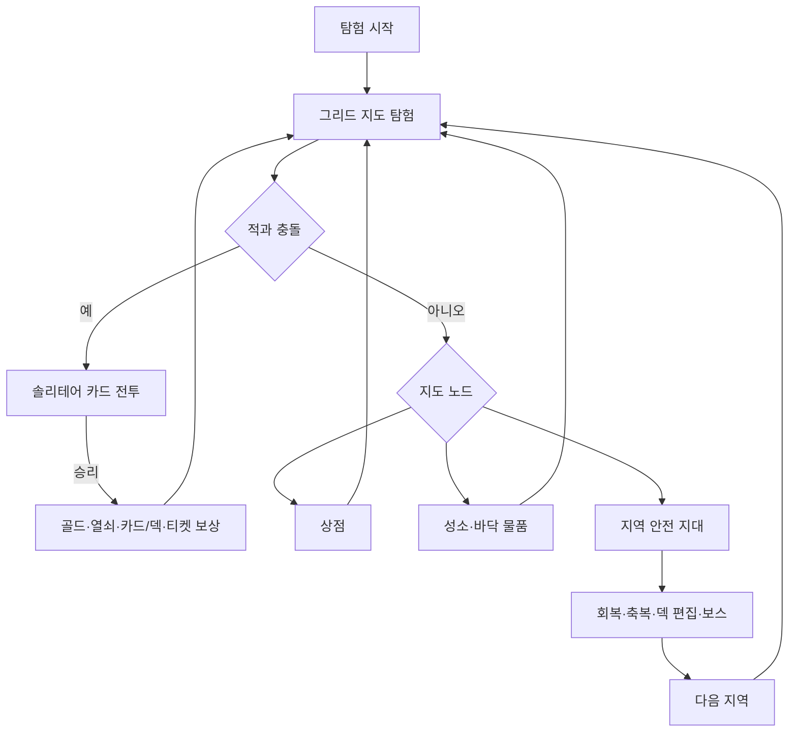

# 현재 게임 규칙

마지막 갱신: 2026-11-03

이 문서는 과거 기획안이 아니라 갱신 당시 **현재 작업 트리에 구현된 규칙**을 설명한다. 문서와 구현이 충돌하면 `app/`의 현재 코드를 기준으로 문서를 고치며, `tests/`는 동작을 검증하는 근거로 참고한다. 문서에 맞추기 위해 게임 동작을 바꾸지 않는다.

## 1. 게임의 큰 흐름

핵심은 두 층이다. 지도에서는 제한된 시야 안에서 움직이는 적과 지형을 읽고 경로를 선택한다. 전투에서는 여러 파일에 쌓인 카드를 꺼내 쓰거나 솔리테어 규칙으로 재배열하여 덱의 순서와 효과를 관리한다.

## 2. 지도와 탐험

### 지도 크기와 이동

- 같은 바닥·바위 타일도 좌표마다 고정된 명도·채도 차이를 조금씩 준다. 바닥의 지역별 색감과 바위 무늬는 공유한다.
- 지도 상단 ‘설정’에서 ‘잠깐!’(전투 전 사용할 덱 확인)과 애니메이션 툴팁을 켜고 끄며 단축키 안내를 본다. 두 설정은 기본 켜짐이며 새로고침·새 탐험 후에도 유지한다. 애니메이션을 꺼도 기본 키워드 설명은 유지하고 예시 창·대기 진행 바만 숨긴다. 설정 창은 Esc·닫기·창 밖 클릭으로 닫으며 열린 동안 지도 키 입력을 막는다.
- 지도 플레이어의 `@` 문자는 표시하지 않는다. 현재 위치 타일의 강조는 유지한다.
- 승리한 전투 타일에는 어두운 붉은 핏자국을 남긴다. 아이템·장소 표시 아래에 놓으며 새로고침 뒤에도 유지하고 새 탐험 때 지운다.

- 가로 좌표는 `-160~160`이다.
- 총 7개 지역의 틀이 있으며, 각 지역은 321×31칸이다.
- 지역 사이에는 단단한 바위 5줄이 있다.
- 플레이어와 적은 상하좌우·대각선을 포함한 8방향으로 이동한다.
- 기본 시야는 플레이어 중심 반경 3, 즉 최대 7×7이다. 바위로 연결이 끊긴 칸은 같은 정사각형 안이어도 보이지 않는다.
- 이미 방문한 길을 클릭하면 적이 시야에 있어도 빠른 이동할 수 있다. 출발 시 보이던 적은 허용하지만 새로운 적이 시야에 들어오면 멈추며, 실제로 적과 충돌하면 전투에 들어간다.
- O는 알려진 길을 따라 가까운 미탐사 칸으로 자동 여행한다. 새 적·아이템·특수 장소가 시야에 들어오면 정지하고, 시야에 적이 있으면 시작할 수 없다. O 또는 Esc로 중단한다. 디버그에서도 순간이동 대신 같은 이동 처리를 사용한다.
- 바닥 물품은 인벤토리의 간소화 외형을 타일에 그린다. 대표 물품은 덱 > 카드 > 티켓 순이며, 물품이 두 개 이상이면 우측 하단에 기존 초록 표시를 덧붙인다.
- 지도 카메라는 드래그 및 확대·축소할 수 있다.
- 시작·불러오기·새 탐험에서는 ‘맵 생성 중…’ 진행률 창 아래에서 7개 지역의 기본 지형을 미리 준비한 뒤 입력을 허용한다. 디버그로 새 지역의 콘텐츠를 준비할 때도 로딩창을 사용하며, 준비 중 지도 이동·초기화 입력을 막는다.
- 데스크톱 맵 화면의 최대 너비는 1440px이며 지도 표시 높이는 `화면 높이 - 155px`다. 타일은 136×136px 정사각형을 유지한다.
- 지형은 벽에서 시작해 굽은 통로·갈림길·우회로를 연결하고, 위치별 폭 변화와 일부 작은 공터·짧은 막다른 가지를 섞는다. 플레이어가 속한 메인 대륙은 전체 바닥의 약 97%를 목표로 하며 90% 이상을 보장한다. 작은 고립 바닥은 남기되 일반 적·물건·무작위 특수 장소는 생성하지 않는다.
- 지역마다 수제 미니 지형 2개를 데이터에서 선택해 회전·반전·배치한다. 현재 예시는 소용돌이 금고와 기둥 금고다. 내부 벽과 완충 영역은 생성 중 보호하고 지정 출입구만 통로에 연결한다. 포탈과 수제 지형의 모든 출입구·지정 장소는 시작점에서 8방향 이동으로 도달 가능하다.
- 바위 타일의 반복 문구는 표시하지 않고 호버 설명과 접근성 이름으로 안내한다. 폭탄의 지형 파괴 규칙은 유지한다.

### 일반 지도 생성

| 요소 | 현재 규칙 |
|---|---|
| 덱 금고 | 필드 40~46개 + 수제 지형 2개 = 지역당 총 42~48개 |
| 상점·피의 상점 | 필드에 각각 지역당 3~4개. 안전 지대 고정 상점은 별도 |
| 단단한 바위 | 통로·공터·수제 지형 밖의 기본 지형. 별도 확률 추첨 없음 |
| 지역 포탈 | 지역당 14~18개. 가로 구간마다 분산하며 깊이 2~30칸에서 `(깊이+1)²` 가중치로 아래쪽에 집중 |
| 바닥 물품 | 메인 대륙의 유효한 빈칸마다 0.5% |

각 지역 생성 때 종류별 목표 개수를 범위 안의 정수로 균등 추첨한다. 종류마다 가로 구간을 나누고 각 구간의 비어 있는 메인 대륙 바닥에서 하나씩 고른다. 같은 종류끼리와 다른 장소에 지나치게 가까운 후보를 피하며 위치·깊이는 무작위성을 남긴다. 수제 지형의 지정 장소는 일반 목표 개수에서 차감하지 않고 별도로 추가한다.

성소·보물 상자·무작위 축복·회복은 계속 임시 중단한다. 종류·기능·기존 상대 가중치 데이터는 SPECIAL_NODE_DEFINITION_WEIGHTS에 보존하지만 활성 장소의 개수 추첨에는 사용하지 않는다. 안전 지대의 고정 회복·축복·상점·보스·포탈은 유지한다. 추출 성소 대신 이전 위·아래 성소 바닥에 추출 티켓을 하나씩, 지역마다 총 2개 놓는다. 콘텐츠를 처음 생성할 때 한 번만 놓으므로 재방문·줍기 뒤 다시 생성하지 않는다. 안전 지대 시설도 필드 장소 목표 개수와 별도다.

바닥 물품은 카드 80%, 티켓 20%다. 카드인 경우 희귀 5%, 일반 30%, 특별 65% 비율로 풀을 고른다.

| 노드 | 효과 |
|---|---|
| 추출의 성소 | 덱 하나에서 희귀 카드를 제외하고 최대 2장을 바닥으로 꺼낸다. |
| 건강의 성소 | 최대 체력 +5. 현재 체력은 바뀌지 않는다. |
| 심안의 성소 | 20회 이동 동안 시야 거리 +2를 얻는다. |
| 변환의 성소 | 인벤토리 카드 2장을 변환한다. |
| 피의 상점 | 일반 상점과 같은 재고를 생성한 뒤 골드 가격을 15로 나누고 올림한 체력을 가격으로 사용한다. 구매 후 체력이 최소 1 남아야 한다. |
| 보물 상자 | 무작위 보상을 주고 큰 소리를 내 적을 깨울 수 있다. |
| 덱 보관소 | 맵에 덱 이름을 표시한다. 발견한 타일은 거리·현재 시야와 관계없이 호버하면 구성·에디션·용량을 툴팁으로 보여준다. 인벤토리와 같은 정렬·xN 묶음·빈 일반/희귀 슬롯을 사용하며, 카드 위에서는 상세 미리보기도 뜬다. 열쇠 3개로 개방하면 같은 덱이 바닥에 떨어진다. 한 번만 개방할 수 있다. |

금고 호버 툴팁은 타일 가장자리와 1px 겹쳐 닿도록 배치한다. 닫힘 지연은 없으며 마우스가 타일 또는 툴팁 안에 있으면 유지하고 모두 벗어나면 즉시 닫는다. 카드 상세 외형은 인벤토리와 같고, 카드 키워드·에디션·버프/디버프 설명은 공통 Pretendard 12px 글꼴·줄 간격을 사용한다.

지역 포탈은 같은 지역의 안전 지대로 이동시킨다. 안전 지대 포탈은 다음 지역 시작점으로 이동시킨다. 어느 포탈이든 이용하면 보유 열쇠가 모두 사라진다. 열쇠가 남아 있으면 “보유한 열쇠가 모두 사라집니다.” 경고와 “이번 런 동안 경고하지 않음” 체크를 표시한다. 취소하면 이동·열쇠·경고 설정을 바꾸지 않는다. 경고 생략 설정은 같은 런의 저장·복원에 유지하고 새 탐험에서 초기화한다. 열쇠가 없으면 경고하지 않는다.

### 지도 검색과 카르마

Ctrl+F(맥은 ⌘F)는 브라우저 찾기보다 먼저 지도 검색 창을 연다. 발견한 칸만 검색하며 기본은 현재 지역의 미개방 금고다. 검색어가 없으면 해당 금고 전체를 표시하고 덱 이름·포함 카드명·에디션으로 찾는다. 아이템·특수 장소·전체 필터, 모든 지역 선택, 개방 금고 포함을 지원한다. 왼쪽 결과를 고르면 오른쪽에서 기존 금고 카드 그래픽과 상세 호버를 재사용한다. ‘위치 보기’는 플레이어를 옮기지 않고 카메라를 이동해 타일을 잠시 강조한다. 목록은 창을 열 때만 만들며 미발견 콘텐츠를 생성하거나 읽지 않는다.

카르마는 포탈 이용 이후 전투 승리 12회째에 1단계로 생긴다. 13회째는 2단계이며 이후 승리마다 +1단계다. 한 전투는 적 마릿수와 관계없이 1회로 센다. 다음 전투의 모든 적(소환 포함)은 단계당 힘 +1·최대 체력 +10%를 얻는다. 최대 체력 배율은 `1+0.1×단계`이며 버림한다. 축복과 같은 지도 칸에 보라색 디버프로 표시한다. 승리 횟수는 탐험 저장·복원에 유지하며 포탈을 실제로 타거나 새 탐험을 시작하면 완전히 초기화한다. 포탈 경고를 취소하면 유지한다.

지도 티켓은 필드의 미발견 특수 장소만 찾고 안전 구역 안쪽 시설은 후보에서 제외한다. 찾을 대상이 없으면 티켓을 소비하지 않는다.

### 오버맵 적

- 탐험으로 새 지도 칸을 생성할 때 유효한 빈칸마다 4.5% 확률로 일반 적을 배치한다. 시야 주변과 여유 반경 안의 새 칸을 한 번씩 생성한다.
- 각 지역 시작점 중심 9×9(체비쇼프 반경 4) 안에는 일반 적을 생성하지 않는다. 포탈 도착 시 주변 적 제거 범위는 기존 반경 2를 유지한다.
- 1~3지역에만 현재 일반 적 풀이 있다. 4~7지역은 지도 틀만 있고 전투 조우는 없다.
- 적은 3% 확률로 다음 지역 풀에서 조기 출현한다. 다음 풀이 없으면 현재 풀을 쓴다. 미래 지역 적은 영구 `Zzz`로 인식·이동·소음 각성을 하지 않으며 직접 그 칸에 들어가면 전투한다.
- 적 위치는 직접 관측한 칸 단위로 기억된다. 그 칸을 다시 보면 기억을 현재 상태로 갱신한다.
- 플레이어가 적 칸에 들어가거나 적이 플레이어 칸에 들어오면 즉시 전투가 시작된다.

| 표시 | 상태 | 행동 |
|---|---|---|
| `Zzz` | 잠듦 | 이동하지 않는다. 거리장 1·2·3에서 각각 50%·10%·0% 확률로 깨어난다. |
| `?` | 깨어남 | 거리장 1·2·3에서 각각 50%·10%·0% 확률로 경계 상태가 된다. 거리장 4 이상이면 매 턴 10% 확률로 잠든다. 상태가 유지되면 50% 정지, 50% 무작위 이동한다. |
| `!` | 경계 | 95% 확률로 플레이어에게 접근하고 5% 정지한다. 거리장 5 이상이면 `?`로 돌아간다. |

기본 최대 인식 거리는 거리장 2이며, 어둠 티켓의 인식 거리 −1이 있으면 거리장 1까지만 인식한다.

상태 변화 자체가 그 적의 한 행동을 소비한다. 경계 적은 바위와 다른 적을 반영한 8방향 거리장을 사용한다. 여러 적은 먼저 목적지를 예약하고 동시에 움직이며 일반 칸에서는 겹치거나 서로 자리를 맞바꾸지 않는다. 플레이어가 있는 칸에는 여러 적이 함께 들어올 수 있다. 여러 조우와 충돌하면 체력을 이어서 순서대로 전투하고, 각 전투의 보상은 해당 전투 칸에 남긴다.

## 3. 안전 지대

- 각 지역에는 일반 지도와 떨어진 별도 안전 지대가 있다.
- 모든 안전 지대에는 축복·전체 회복·상점·다음 지역 포탈이 있다. 추출 성소 대신 왼쪽 위·아래 바닥에 추출 티켓이 하나씩 있다.
- 1~3지역에는 추가로 고정 보스 1명이 있다. 회복의 성소 1개·추출의 성소 2개의 배치 데이터도 보존하며 현재는 빈칸이다.
- 보스는 안전 지대 연결부에 고정되고 처음부터 `!` 상태다.
- 보스가 살아 있는 동안 그 안전 지대에서는 덱 편집을 열 수 없다.
- 전체 회복과 축복 선택은 각 노드에서 한 번만 쓸 수 있다.
- 회복의 성소는 최대 체력의 30%(내림)를 회복하며 기본적으로 사용 뒤 무너진다. 금단의 지식이 있으면 이 회복량은 0이다.
- 추출의 성소는 덱 하나에서 최대 2장을 바닥으로 꺼낸다. 덱에는 최소 1장이 남아야 하며 기본적으로 사용 뒤 무너진다. 고고학자의 성소 보존 판정은 회복·추출 성소에도 적용된다.

## 4. 현재 조우 목록

아래 표는 코드에 정의된 생성 체력의 상한이다. 일반 적은 `floor(상한×0.9)`부터 상한까지의 정수 중에서 뽑으며, 쥐는 예외적으로 상한-1부터 상한까지 뽑는다. 인형술사는 최대 체력 12로 고정한다. 뽑힌 값이 초기 체력과 표시 최대 체력이 된다. 보스 체력은 표의 고정값이다. 신들의 비탄이나 지도 폭탄에 따른 전투 진입 체력 감소는 별도로 적용된다.

### 1지역

`3랜덤1`은 첫 행동을 셋 중 균등 선택하고, 이후 직전 행동을 제외한 둘 중 균등 선택한다. 아래 `/`는 선택지이며, `→`는 고정 순서다. 공격은 별도 표시가 없으면 물리, 힘·증폭·저항 보정 전 수치다. 힘과 자기 상태 획득은 공격 뒤 적용하며 플레이어 취약·약화는 다음 턴 자연 감소 후 적용한다.

| 적 | HP 상한 | 행동 | 패시브·운영 |
|---|---:|---|---|
| 주황 슬라임 | 50 | 공격 10 / 약화 2 / 공격 7+힘 3 | 3랜덤1. 시작 시 유독성 점액 1장 |
| 하수구 쥐 | 28 | 공격 3×2 / 공격 6 / 공격 3+힘 3 | 혼합 후보. 3랜덤1. 매 행동 버리기 1, 파일 맨 위 중 높은 희귀도 우선 |
| 쥐 3마리 | 각 13 | 각 공격 4 고정 반복 | 실제 HP 각 12~13 |
| 굶주린 들개 | 24 | 공격 5 → 10 → 이후 5 고정 | 혼합 후보. 두 번째 행동의 돌진 10을 미리 예고 |
| 칼잡이 | 20 | 공격 6+약화 1 / 공격 4×2 / 공격 6+힘 3 | 혼합 후보. 3랜덤1 |
| 진흙 인형 | 50 | 공격 12 / 공격 9+회복 6 / 증폭 2 | 3랜덤1 |
| 꼭두각시 거병 | 54 | 공격 7+약화 1 / 공격 9+증폭 1 / 공격 11+취약 1 | 3랜덤1. 인형술사와 함께 등장 |
| 인형술사 | 12 고정 | 조종 유지, 공격 없음 | 쓰러지면 함께 나온 거병의 다음 행동 한 번 취소. 추가 턴에는 소모되지 않으며 취소된 행동의 공격·강화·디버프가 모두 발동하지 않음 |
| 눈치보는 산적 | 26 | 공격 4+약화 1 / 공격 3×2 / 공격 6 | 혼합 후보. 3랜덤1. 플레이어 에너지 0 이하이면 해당 행동 임시 힘 5 |
| 실을 짜는 거미 | 60 | 공격 8+취약 1 / 공격 6×2 / 힘 4 | 3랜덤1. 턴당 첫 솔리테어 후 받는 다음 타격 피해 +6 |
| 화약 두꺼비 | 26 | 공격 4 → 4 → 폭발 12 후 자폭 | 혼합 후보. 폭발을 미리 예고 |
| 알집 바퀴 | 48 | 첫 행동 새끼 소환 → 이후 공격 10 / 새끼 소환 / 취약 2 | 첫 행동 뒤 3랜덤1. 새끼 HP 12·공격 4, 최대 2마리, 소환 턴에는 행동하지 않음 |
| 보스: 검은 슬라임 | 87 | 공격 10 → 방어 10+힘 2 반복 | 시작 시 유독성 점액 2장. 기존 보스 유지 |

1지역 일반전은 50%로 혼합 후보 5종 중 서로 다른 두 종류를 한 마리씩, 나머지 50%로 주황 슬라임·쥐 3마리·진흙 인형·꼭두각시 거병+인형술사·실을 짜는 거미·알집 바퀴 중 하나를 고른다. 혼합의 10개 조합은 각각 전체의 5%이며, 나머지 여섯 조우는 각각 전체의 1/12다. 쥐 3마리와 거병·인형술사 조우까지 포함하면 처음부터 다수전인 비율은 2/3(약 66.7%)다. 보스·3% 조기 출현·소환은 별도다.

대표와 행동 순서를 고정한 혼합 레시피 20개는 조우 66~85에 추가했다. 필드에는 `굶주린 들개 + ?`처럼 표시한다. 기존 3·17·18·21·23번은 대표 종류를 유지하는 고정 혼합 레시피로 변환하며 지도·관측 기억·실제 전투를 일치시킨다. 24번 죄수는 삭제 상태를 유지한다. 알집 바퀴의 새끼는 별도 보상이 없고 본체가 죽어도 남은 새끼를 처치해야 한다.

### 2지역

| 적 | HP 상한 | 행동 | 패시브·운영 |
|---|---:|---|---|
| 골렘 | 112 | 약화 2 → 저항 2 → 공격 25+힘 5 반복 | 힘은 공격 뒤 획득하므로 공격 턴마다 25→30→35로 성장 |
| 도깨비 | 82 | 공격 8×2 / 공격 7×3 / 증폭 2 | 3랜덤1. 턴 종료 시 힘 1. 첫 파일 아래 유물(사용 시 도깨비 힘 -4) |
| 저주술사 | 68 | 취약 3 → 이후 공격 20 고정 | 기존 조우 번호 6으로 복원. 전부 물리 공격 |
| 화약 운반병 | 30 | 공격 5 / 공격 3×2 / 공격 4+화약 2 | 혼합 후보. 화약 6으로 시작, 사망 시 자신 외 모두에게 화약만큼 물리 피해 |
| 핏빛 광전사 | 88 | 공격 11 / 공격 6×2 / 공격 16+자신 약화 1 | 3랜덤1. 체력 절반 이하에서 한 번만 힘 7 |
| 수색견 | 35 | 공격 5 고정 | 혼합 후보. 플레이어 손패가 남아 있으면 임시 힘 4 |
| 대형 망치병 | 44 | 공격 10, 완전히 막히면 휴식+힘 1 | 혼합 후보. 휴식 뒤 공격으로 복귀 |
| 족쇄 간수 | 72 | 공격 5×2 / 공격 6+약화 1 / 증폭 2 | 3랜덤1. 플레이어 기본 에너지 회복 -1. 최대 에너지와 카드 효과는 유지 |
| 봉인 파수꾼 | 39 | 공격 5 / 공격 3×2 / 증폭 2 | 혼합 후보. 매 플레이어 턴 카드가 있는 파일 하나의 드로우를 봉인. 솔리테어 이동은 허용 |
| 발효 슬라임 | 45 | 공격 10 / 공격 5×2 / 증폭 2+저항 2 | 혼합 후보. 시작 시 발효 점액 1장. 회복 행동 없음 |
| 공허 해파리 | 60 | 마법 공격 8 고정 | 추가 기믹 없음 |
| 피의 기수 | 90 | 공격 6×2 / 공격 3×3+자신 취약 1 / 공격 7+취약 1 | 3랜덤1. 적 턴 종료 시 살아 있으면 양쪽 힘 +2. 첫 공격에는 보정 없음. 추가 턴에는 발동하지 않음 |
| 압수관 | 35 | 공격 7 / 방어 8 / 취약 1 부여 | 혼합 후보. 희귀 카드 1장을 압수하며 처치 시 손패로 반환. 호위병 삭제 |
| 보스: 광대 | 137 | 물리 20 → 마법 20 → 힘 3 반복 | 매 행동 무작위 파일 카드 5장 버리기. 기존 보스 유지 |

2지역 일반전은 50%로 단독 7종(골렘·도깨비·저주술사·핏빛 광전사·족쇄 간수·공허 해파리·피의 기수) 중 하나, 50%로 혼합 후보 6종 중 서로 다른 두 마리를 고른다. 혼합의 15개 조합은 각각 같은 확률이다. 대표와 행동 순서를 고정하는 순서 있는 조합 30개는 조우 36~65를 사용하며 필드에는 `수색견 + ?`처럼 표시한다. 단독 조우는 2·4·6·27·30·33·34번이다. 기존 26·28·29·31·32·35번은 대표 종류를 유지하는 고정 조합으로 변환하고 지도와 관측 기억에도 같은 변환을 적용한다. 마나 야수+도깨비불 8은 삭제 상태를 유지한다. 보스와 3% 다음 지역 조기 출현은 별도다.

저항/취약, 증폭/약화는 각각 같은 부호 있는 지속시간을 공유하며 서로 상쇄된다. 음수 상태는 양수 지속시간과 취약·약화 이름으로 표시한다. 공격 외인 화약 폭발에는 이 배율을 적용하지 않는다. 폭발은 방어를 소모하고 1UP 및 연쇄 폭발을 처리한다. 압수관은 파일 배치가 끝난 뒤 첫 드로우 전에 파일의 희귀 카드 1장을 무작위로 가져간다. 남은 카드를 다시 배치하지 않고 빈 파일도 유지하며, 새로 노출된 맨 위 카드는 공개한다. 압수된 카드는 살아 있는 압수관이 보유하는 동안 리셔플에 들어가지 않고 처치하면 즉시 손패로 반환한다.

### 3지역

| 조우 | 생성 체력 상한 | 핵심 행동 |
|---|---:|---|
| 미라 사제 | 87 | 시작 가호 5. 가호 2+다음 턴 저항 -1 / 마법 16 / 물리 20 |
| 미라 전사 | 125 | 매 플레이어 턴 광폭 1. 물리 4×3 / 16 / 5×2+다음 턴 저항 -1 |
| 지룡 | 118 | 모든 파일에 흙 1장+다음 턴 저항 -1 / 물리 15 / 마법 20 |
| 가시 딱정벌레 2마리 | 각 56 | 가시 4. 다음 턴 저항 -1 / 물리 10 / 플레이어 힘·강인함 각각 -2 중 직전과 다른 행동 |
| 보스: 거대 지룡 | 187 | 첫 행동 파일마다 돌 2장, 이후 돌 1장+힘 4 / 물리 12 / 물리 6×2 |

가호는 피해를 받는 횟수를 막고, 가시는 공격받을 때 플레이어에게 반격 피해를 준다.

## 5. 플레이어와 덱

| 항목 | 기본값 |
|---|---:|
| 최대 체력 | 50 |
| 인벤토리 | 15칸 |
| 보유 덱 케이스 | 최대 3개 |
| 시작 덱 크기 | 20장 |
| 시작 덱 용량 | 25장 |
| 시작 덱 희귀 슬롯 | 빈 슬롯 1칸. 전체 25칸 중 희귀 1칸·일반 24칸 |
| 전투 시작 에너지 | 3 |
| 전투 시작 별 | 2 |

시작 덱은 타격 6장, 방어 6장, 몸 사리기·돌진·잽·전투 교본·자와 컴퍼스·기회 포착·기회 창출·별의 장막 각 1장이다. 시작·일반 카드의 모든 종류를 한 장씩 넣고 타격·방어를 각각 5장 추가한다. 시작 덱에는 에디션이 붙지 않는다.
새 탐험 시작 시 추가 타격·방어 카드는 지급하지 않는다. 시작 인벤토리는 비어 있으며 추출 티켓을 지급하지 않는다.

새 탐험과 다음 지역 진입 시 신들의 비탄 충전은 3회다. 충전이 남아 있으면 다음 전투에서 적들의 진입 체력을 30% 줄이고 1회를 소모한다. 지역 포탈로 같은 지역의 안전 지대에 들어가면 남은 충전은 0이 된다.

발견 덱의 지역 번호는 `k`(1지역=1)다. 먼저 독립적인 3면체 주사위 3개의 합에서 6을 뺀 `s=3d3−6`을 굴린다. `s=−3,−2,−1,0,1,2,3`의 확률은 각각 `1,3,6,7,6,3,1 / 27`이다. 이후 `x+y+z=s`, `k+x≥−1`, `k+y≥0`, `k+z≥0`을 만족하는 정수 조합 중 거리 `r=√(x²+y²+z²)`에 따른 가중치 `1.75^(−r/√(1+0.2(k−1)))`로 하나를 고른다. 최소 용량은 15장이다. 각 s 안에서 가중치를 정규화하며 희귀 슬롯이 전체 용량을 넘는 조합은 제외한다.

- 기본 용량: `20+5(k+x)`
- 희귀 슬롯 수: `C=k+y`
- 에디션 점수 예산: `10(k+z)`

거리 가중치의 기준 밑은 1.75, 지역별 확산 계수는 0.2다. 1지역에는 `1.75^(−r)`를 쓰고 이후 거리 척도를 `√(1+0.2(k−1))`로 늘린다. 따라서 지역이 아주 커지면 `평균 r / √k`는 `2√0.2 / ln(1.75) ≈ 1.60`으로 수렴한다. 저지역은 정수 격자와 용량 제약 때문에 정확한 비례가 아니며 평균 r은 1지역 약 1.61, 3지역 약 2.92, 7지역 약 4.69다.

희귀 슬롯은 각각 독립적으로 80% 확률로 채운다. 희귀 슬롯 0칸과 희귀 카드 0장을 허용하며, 희귀 슬롯이 C개일 때 실제 희귀 수는 이항분포 `Binomial(C,0.8)`를 따른다. 나머지 `용량−C`칸도 각각 독립적으로 빈칸·시작·일반·특별을 25%씩 뽑는다. 시작·일반·특별 카드의 실제 종류도 해당 등급의 전체 풀에서 매번 독립적으로 균등 복원추출한다. 덱 크기 축복의 용량 +5는 생성이 끝난 마지막에 빈칸으로 적용한다. 이미 생성·저장된 덱은 다시 생성하지 않는다.

새 발견 덱에는 최초 생성 시의 `k,s,x,y,z`를 함께 저장한다. 디버그 모드에서는 인벤토리·금고 상세에 `s,x,y,z`를 표시하며 작은 덱 선택·바닥 표시는 이름의 호버 설명에서 확인한다. 카드 이동·확장 티켓·축복 등으로 덱 구성이 바뀌어도 이 값은 최초 생성 기록을 뜻한다. 기록 도입 전 덱과 고정 시작 덱에는 값을 추정하지 않고 “생성값 기록 없음”으로 표시한다.

희귀 카드는 코스트와 이름을 밝은 금색(`#ffe08a`), 등급 띠를 단색 보라색(`#7138a6`)으로 표시한다. 간소화 스타일은 기존 레이아웃을 유지하며, 희귀 카드 본체 바탕은 일반 카드와 같은 `#f7f4eb`이다. 희귀 카드 테두리는 금색(`#d5a928`) 2px이고, 등급 띠 경계에도 같은 금색 선을 둔다. 텍스처는 희귀 카드 테두리 아래 층에 그린다.

일반 카드 바탕은 전투·목록에서 `#f7f4eb`, 덱 편집과 카드 미리보기에서는 밝기를 낮춘 회백색 `#e1dfd8`를 사용한다.

## 6. 전투와 솔리테어

### 전투 시작과 턴

1. 선택한 덱을 섞어 기본 5장씩 파일에 배치한다.
2. 각 파일의 맨 위 카드만 공개한다.
3. 턴 시작에 비어 있지 않은 각 파일 맨 위에서 한 장씩 손으로 가져온다.
4. 카드를 사용하거나 별을 써서 카드·파일 묶음을 재배열한다.
5. 턴 종료 시 남은 손패를 버린 뒤 적이 행동한다.
6. 다음 플레이어 턴에는 방어를 정리하고 에너지를 회복한 뒤 다시 파일마다 한 장씩 뽑는다.

카드 비행은 출발 시 확대·회전을 보존하고 실제 손패 위치·각도로 착지한다. 턴 종료 버리기는 보존 카드를 제외하며 마지막 카드의 비행 완료 후 적 턴으로 넘어간다. 적 공격의 피해 표시는 전진 정점에 맞추고, 다음 타격은 복귀 후 시작한다. 움직임 줄이기 설정에서는 비행을 생략하며 전투 초기화 시 남은 연출과 오래된 완료 처리를 취소한다.

모든 파일이 비면 버린 카드들을 다시 섞는다. 룰 카드, 이번 전투에서 소멸한 카드와 토큰은 다음 리셔플 대상에서 제외된다.

손패는 원호로 최대 9장까지 한 번에 표시한다. 표시 상한은 화면 폭에 맞춰 9·7·5·3·1장 중에서 정한다. 손패가 9장 이상이고 한 번에 2장 이상 표시할 수 있으면 휠로 한 장씩 이동해 볼 수 있다. 가장자리 밖으로 휠을 더 굴릴수록 저항이 강해지고, 휠 입력 중에도 가장자리로 되돌아오는 힘이 작용한다. 전투 중 스페이스를 누르면 그 순간 손패를 코스트 오름차순으로 정렬하고, 같은 코스트는 높은 희귀도부터 둔다. 사용 불가 카드는 비용 -999로 취급해 가장 앞에 둔다. 이후 카드를 뽑거나 버려도 자동으로 다시 정렬하지 않는다.

단일 대상 카드는 적에게 드래그하거나 카드를 선택한 뒤 적을 클릭해야 한다. 중앙 낙하나 더블클릭으로 첫 적을 자동 지정하지 않는다. 위압도 같은 규칙을 사용하며 전체·무작위·자신 효과는 중앙에서 사용할 수 있다.

사용 가능한 중앙·적 대상 강조는 카드 종류가 아닌 실제 대상 판정을 따른다. 전투 중앙의 안내 메시지 띠는 표시하지 않으며 버리기 선택에는 남은 장수를 적는다. 적의 강화·디버프·파일 버리기는 해당 행동 시점에 대상 위 팝업으로 표시한다.

카드에 약 3초 머무르면 재련·별 키워드에만 기본 설명 옆 강화 애니메이션 창이 나타난다. 강화 창은 설명문 없이 실제 CardFace·뒷면과 파일 3개를 사용하고 전투의 파일 간격·파란 배치 네온·주황 재련 네온을 그대로 공유한다. 별은 항상 타격을 손패→첫 파일→다른 파일로 이동하며 별을 각각 하나 소모한다. 손패는 136×191px, 파일은 120.89×170px이다. 재련은 실제 재련·배치 조건을 만족하는 밑패 위로 드래그하여 이름의 +와 강화 효과가 적용되는 모습을 보여준다. 대기 중 진행 바를 표시한다. 금속학 연구·오딘의 창은 재련 설명만 표시하며 시연은 보류한다. 치환 합금은 이동 카드와 밑패 양쪽의 비용 교환을 표시한다. 한 주기는 5.6초로 이전보다 1.5배 빠르며 관련 예시가 여러 개면 주기마다 전환한다. 실제 전투 상태는 바꾸지 않는다. 창은 화면 공간에 맞춰 크기와 위치를 조절하고 드래그·스크롤·창 전환·Esc 입력 때 닫는다. 움직임 줄이기 설정에서는 정적인 결과를 표시한다.

### 자원과 카드 배치

- 카드 사용은 카드에 적힌 에너지를 쓴다.
- 손패 카드 또는 파일 위쪽의 연속된 카드 묶음을 다른 파일에 놓는 행동은 별 1개를 쓴다.
- 별은 턴마다 자동 회복되지 않는다.
- 파일 배치는 맨 위 규칙, 맨 아래 규칙, 주문 연쇄 규칙을 검사한다.
- 주문 연쇄는 비용이 이어지는 카드로 구성되며, 홍수 피라미드는 4-3-2-1 순서를 사용한다.
- 재련 카드를 조건에 맞는 대상 카드 위에 놓으면 일반 배치와 같은 별 비용을 쓴다. 여러 장을 함께 옮기면 모든 이동 카드가 이동 전 목적지 맨 위 카드와 독립적으로 판정되어 한 번에 여러 장을 재련할 수 있다.

### 피해·방어·상태

- 플레이어 공격에는 힘이 더해진다.
- 물리 방어와 마법 방어는 서로 다른 적 공격만 막는다.
- 강인함은 획득 방어에 더해진다.
- 기존 물리·마법 저항과 물리·마법 취약은 통합 저항·증폭으로 교체했다. 물리·마법 공격과 방어의 속성 구분은 유지한다.
- 저항이 양수이면 받는 공격 피해 ×0.7, 음수이면 ×1.3이다. 증폭이 양수이면 가하는 공격 피해 ×1.3, 음수이면 ×0.7이다. 수치의 절댓값은 지속 턴 수이며 배율의 강도는 중첩되지 않는다.
- 같은 상태의 양수·음수는 합산한다. 정상 턴마다 양수는 -1, 음수는 +1로 0을 향해 변하며 추가 턴에서는 유지한다. 적 행동에서 새로 얻는 상태나 다음 플레이어 턴의 상태 부여는 기존 값의 자연 변동 뒤에 적용해 즉시 사라지지 않게 한다.
- 힘·교본·거미의 다음 타격 보너스 등 고정값을 더한 뒤 증폭·저항·보스 학살자 등 모든 배율을 곱하고 마지막에 타격별로 한 번만 버림한 뒤 방어를 차감한다. 마도서·점액·반사·가시는 저항·증폭을 적용하지 않으며 체력 비용도 제외한다.
- 양쪽의 음수 저항·증폭은 보라색 디버프로 표시한다. 카드에는 내 증폭을 반영하고 적에게 드래그하면 대상 저항과 보스 배율도 반영한다. 적 의도는 공격자의 증폭과 플레이어 저항·취약 보험을 반영한다.
- 보통 방어는 다음 플레이어 턴에 사라진다. `견고한 태세`가 활성화되면 절반을 유지한다.

### 저항·증폭 신규 카드

| 등급 | 이름 | 비용 | 효과 |
|---|---|---:|---|
| 특별 | 기합 | 0 | 증폭 1 |
| 특별 | 파쇄 | 1 | 피해 6, 이후 취약 2 부여 |
| 특별 | 무릎차기 | 1 | 피해 10, 이후 약화 1 부여 |
| 특별 | 가호 | 1 | 저항 2 |
| 특별 | 싸움 준비 | 1 | 다음 플레이어 턴 시작 시 증폭·에너지 각각 2 |
| 특별 | 위압 | 2 | 방어 8, 적 한 명에게 약화 2 |
| 희귀 | 사계절 | 2 | 버리기 3. 증폭·저항 각각 2, 모든 적에게 취약·약화 각각 2 |
| 희귀 | 불굴 | 1 | 저항 5. 소멸 |
| 희귀 | 개박살 | 3 | 피해 15, 이후 취약·약화 각각 3 |

위압은 적을 대상으로 사용한다. 사계절은 자신 외 손패 3장을 먼저 버린다. 싸움 준비는 중첩되며 다음 턴 기본 에너지 회복 뒤 지급하므로 최대 에너지를 넘을 수 있다. 추가 턴도 다음 플레이어 턴으로 취급한다. 이름이 같은 구버전 가호와는 저장 효과 키가 다르다.

### 토큰

| 토큰 | 현재 효과 |
|---|---|
| 유독성 점액 | 사용할 수 없으며 턴 종료 때 손에 있으면 물리 피해 12 |
| 흙 | 사용할 수 없는 파일 방해 카드 |
| 돌 | 사용할 수 없는 파일 방해 카드 |
| 발효 점액 | 0코스트. 에너지 1 획득. 토큰·보존. 턴이 끝나도 손패에서 버려지지 않으며 사용하면 사라짐 |
| 유물 | 사용할 수 없으며 도깨비의 힘을 4 낮춤 |

## 7. 카드 체계

### 핵심 키워드

| 키워드 | 의미 |
|---|---|
| 룰 | 사용 후 버려지지 않고 그 전투의 지속 규칙으로 남음 |
| 보존 | 턴이 끝나도 손패에서 버려지지 않음. 사용·명시적 버리기는 가능 |
| 소멸 | 사용한 전투의 다음 리셔플에서 제외됨 |
| 재련 | 다른 카드 위에 놓아 그 카드의 전투 중 수치·비용 등을 강화 |

카드 효과 설명에서 대괄호 `[ ... ]` 안은 카드를 재련한 뒤의 효과를 미리 보여 준다. 대괄호 밖은 현재 효과이며, 재련 전에는 대괄호 안의 효과가 적용되지 않는다.

### 시작 카드 2종

| 카드 | 비용 | 효과 |
|---|---:|---|
| 타격 | 1 | 피해 6 |
| 방어 | 1 | 물리 방어 5 |

### 일반 카드 8종

| 카드 | 비용 | 효과 |
|---|---:|---|
| 잽 | 0 | 피해 6 |
| 몸 사리기 | 1 | 버리기 1, 물리 방어 8 |
| 돌진 | 2 | 버리기 1, 피해 15 |
| 자와 컴퍼스 | 1 | 피해 6, 별 1 획득 |
| 기회 포착 | 1 | 피해 9, 선택한 파일 맨 위 카드 버리기 |
| 기회 창출 | 1 | 물리 방어 5, 선택한 파일 맨 위 카드 버리기 |
| 별의 장막 | 2 | 물리 방어 10, 별 1 획득 |
| 전투 교본 | 사용 불가 | 손패에 있는 동안 카드 피해와 방어 +2 |

### 특별 획득 풀 38종

재활용, 기합, 파쇄, 무릎차기, 가호, 싸움 준비, 위압, 사서의 특권, 금속학 연구, 별의 샘, 재주넘기, 돌파구, 빛무리, 대형 프리즘, 성운, 휩쓸기, 정리 타격, 준비 운동, 별빛, 얼음 방패, 5연격, 백스텝, 은검, 전략가, 낡은 노심, 판금 갑옷, 과감한 결단, 과감한 돌진, 과감한 회피, 질주, 퀵스텝, 진압, 별의 방주, 묵직한 한 방, 치환 합금, 청동 철퇴, 늑대 부적, 거북이 부적.

- 재활용: 1코스트 룰. 내 턴 동안 직접 버린 카드 1장마다 ★ 1개를 얻는다. 버리기 비용·손패 선택·파일 맨 위 버리기에 적용하고, 카드 사용 후 버림 더미 이동과 턴 종료 자동 버리기에는 적용하지 않는다. 여러 장의 룰은 중첩한다.

응수·천문학 연구·강령학 연구·반전은 임시로 생성·획득·디버그 목록에서 제외한다. 기존 저장에 이미 있는 카드의 정의와 동작은 보존한다.

- 사서의 특권: 2코스트 룰. 턴 시작 시 원하는 파일에서 카드를 1장 뽑는다. 사용 즉시 추가 드로우는 없으며 다음 턴부터 기본 드로우 뒤 파일을 선택한다. 여러 장이면 각각 한 장씩 선택하고 봉인된 파일은 고를 수 없다. 뽑을 카드가 없으면 선택을 생략한다.

- 빛무리: 0코스트. 광채 1장을 손패에 생성한다.
- 대형 프리즘: 3코스트. 광채 3장을 손패에 생성한다.
- 성운: 1코스트. 광채 1장을 손패에 생성하고 ★★를 얻는다.
- 5연격: 1코스트. 피해 2를 5번 준다.
- 백스텝: 0코스트. 방어 5를 얻는다.
- 은검: 1코스트. 피해 12를 주고 마법 방어 5를 얻는다.
- 별의 샘: 1코스트 룰. 매 턴 시작 시 ★를 얻는다.
- 재주넘기: 1코스트. 방어 9를 얻고 ★를 얻는다.
- 돌파구: 1코스트. 피해 9를 주고 ★를 얻으며 카드 1장을 뽑는다.
- 늑대 부적: 특별 등급, 사용 불가. 전투 덱에 있는 장수마다 힘 1을 얻는다. 인벤토리나 다른 덱에 있으면 발동하지 않는다.
- 거북이 부적: 특별 등급, 사용 불가. 전투 덱에 있는 장수마다 강인함 1을 얻는다. 인벤토리나 다른 덱에 있으면 발동하지 않는다.
- 퀵스텝: 1코스트. 카드를 2장 뽑는다.
- 정리 타격: 1코스트. 피해 9를 주고 선택한 파일 맨 위 카드 1장을 버린 뒤 카드 1장을 뽑는다. 버리기를 마치기 전에는 드로우를 할 수 없으며 버린 뒤 뽑을 카드가 없으면 선택을 종료한다.
- 과감한 회피: 1코스트·버리기 2. 방어 13을 얻는다.
- 싸움 준비: 2코스트. 다음 턴 시작 시 증폭과 에너지를 각각 2 얻는다.
- 판금 갑옷: 1코스트. 방어 5와 저항 1을 얻으며 재련 시 저항 2를 얻는다. 재련 조건은 3코스트다. 철벽·카드 가호는 삭제했고 구버전 저장에서도 제거한다.
- 광채: 0코스트 토큰 공격. 기본 피해 4이며, 이번 턴에 먼저 사용한 다른 광채마다 피해가 4 증가한다.

이 그룹에는 룰·소멸·재련, 드로우와 자원 변환, 광역 공격, 반사, 수동 지속 효과 등 전투 구조를 바꾸는 카드가 집중되어 있다. 개별 수치의 단일 기준은 `app/game/cards.ts`의 카드 정의이며, 비용·재련·배치 판정은 `app/game/cardEffects.ts`에 있다.

### 희귀 획득 풀 19종

사계절, 불굴, 개박살, 소원, 병법서, 진화론, 책 펼치기, 흑요석 단검, 연사, 대전략가, 초신성, 유성우, 대분배, 견고한 태세, 법학 연구, 경제학 연구, 광학 연구, 광행시간, 오딘의 창.

- 소원: 0코스트. 무작위 희귀 카드 3장을 생성하고 토큰 속성을 부여한다. 소멸.
- 병법서: 2코스트, 소멸. 사용 시 힘·강인함 +4. 손패에 있는 동안에도 카드의 피해·방어 계산에 +4가 적용된다.
- 진화론: 2코스트 룰. 사용 즉시 힘·강인함 +1을 얻고 내 턴 시작마다 반복한다.
- 대전략가: 1코스트, 소멸. ★★★를 얻고 카드를 2장 뽑는다.
- 책 펼치기: 1코스트. 비어 있지 않은 모든 파일에서 카드 1장씩을 뽑는다.
- 법학 연구: 0코스트 룰. 내 룰 카드 비용을 1 낮춘다.
- 경제학 연구: 2코스트 룰. 사용한 장마다 에너지 사용 하한이 -3씩 내려간다.
- 연사: 1코스트, 소멸. 다음에 사용하는 공격 카드가 두 번 발동하며, 공격할 때까지 턴이 지나도 효과가 유지된다.
- 마도서: 임시로 신규 획득·생성·디버그 목록에서 제외한다. 기존 저장 카드의 동작(손패에 있는 동안 카드를 낼 때마다 마법 피해 1·★ 획득)은 유지한다.
- 유성우: ★를 모두 소모하고 그 수만큼 무작위 적에게 피해를 7씩 준다.
- 광행시간: 1코스트. 다다음 턴 시작 시 광채 3장을 손패에 생성한다.
- 초신성: ★★★를 잃고 에너지 3을 얻는다.
- 대분배: 0코스트 룰. 빈 파일을 추가하고, 이후 리셔플 때 파일의 카드 수를 균등하게 맞춘다.
- 견고한 태세: 2코스트. 방어 10을 얻고 턴 종료 시 방어와 마법 방어를 절반 보존한다.
- 광학 연구: 0코스트 룰. 매 플레이어 턴 시작 시 활성화된 장마다 광채 1장을 손패에 생성한다.
- 턴 시작 에너지는 `min(현재 에너지 + 최대 에너지, 최대 에너지)`로 회복한다. 이 규칙은 추가 턴에도 적용한다.

`흑요석 단검`은 비용 2의 희귀 카드다.
공격 카드 위에 최대 5회 재련할 수 있으며, 재련할 때 밑패를 소멸시키고 그 카드의 기본 피해량을 자신의 피해량에 더한다.

### 전설 카드 6종

호롤로지움, 오피쿠우스, 아리에스, 히드라, 오리온, 카시오페이아가 구현 및 디버그 카드 목록에 정의되어 있다. 그러나 현재 일반 전투 보상, 발견 덱 생성, 상점에는 전설 획득 경로가 연결되어 있지 않다.

`ALL_CARD_BLUEPRINTS`에는 시작 2종·일반 8종·특별 39종·희귀 19종·전설 6종, 총 74종이 정의되어 있다. 특별 39종 중 `무쇠 난동` 1종은 레거시이므로 일반 특별 획득 풀은 38종이다. 별도 생성 카드 6종을 더한 디버그 전체 덱은 80장이다. 임시 제외 5종은 별도 목록에 정의만 보존하며 전설 카드도 일반 획득 경로에는 연결되지 않는다.

## 8. 덱 에디션

발견 덱의 에디션은 지역 생성식의 에디션 예산에서 고른다. 남은 예산 이하이고 충돌하지 않는 에디션만 후보가 되며, 후보별 선택 가중치는 `에디션 점수^1.2`다. 같은 에디션은 중복되지 않는다.

| 에디션 | 점수 | 효과 |
|---|---:|---|
| 추가 파일 | 5 | 전투 시작 시 빈 파일 1개 추가 |
| 빠른 망치 | 10 | 전투 시작 시 재련 가능한 무작위 덱 카드 1장을 재련. 치환 합금·흑요석 단검 제외 |
| 방호 태세 | 5 | 전투 시작 시 방어 5 |
| 별+ | 5 | 전투 시작 시 ★ 1개 |
| 드로우+ | 5 | 전투 시작 시 무작위 파일에서 1장 뽑기 |
| 별++ | 10 | 전투 시작 시 ★ 2개 |
| 에너지+ | 10 | 전투 시작 시 에너지 +1 |
| 별+++ | 20 | 전투 시작 시 ★ 3개 |
| 저항 | 30 | 전투 시작 시 통합 저항 2 |
| 여백의 미 | 30 | 빈 파일 하나당 힘 +2 |
| 망치질 | 30 | 재련할 때마다 ★ 1개 |
| 하이랜더 | 30 | 중복 카드 없이 덱이 가득 차 있으면 최대 에너지 +1 |
| 지속 드로우 | 40 | 매 턴 시작 시 무작위 파일에서 1장 뽑기 |
| 재활용+ | 40 | 턴 종료 시 남은 에너지 1당 ★ 2개 |
| 별+++++ | 40 | 전투 시작 시 ★ 5개 |
| 에너지+++ | 40 | 전투 시작 시 에너지 +3 |
| 아드레날린 | 50 | 전투 시작 시 아드레날린 카드 1장 |
| 지속 에너지 | 50 | 최대 에너지 +1 |
| 거인 | 50 | 전투 시작 시 힘 +3·강인함 +3 |
| 압축 | 60 | 파일마다 4장씩 배치 |
| 무적 | 100 | 전투 시작 시 무적 1 |

`재활용`과 `탐욕` 에디션은 삭제했으며 기존 소지·바닥·미개방 금고의 덱도 복원할 때 제거한다.

빠른 망치는 파일 배치 전에 전투용 카드 복사본 한 장만 강화한다. 적합한 카드가 없으면 건너뛴다. 재련 횟수에 포함하며 오딘의 창 비용 감소·망치질 에디션·대장장이 축복에도 반영하고 리셔플 후에도 유지한다. 소지 덱의 원본은 바꾸지 않는다.

## 9. 전투 보상과 발견 덱

새로 생성하는 덱 이름은 용량이 클수록 대체로 길다. 글자 수는 용량/10의 반올림값에 −1~1을 더해 정하고 최소 2·최대 12글자다. 기존 이름과 플레이 중 용량 변경에 따라 이름을 다시 만들지는 않는다.

- 일반 전투 골드는 지역 번호 `n`에 따라 `floor(10×1.3^(n-1))`~`floor(15×1.3^(n-1))`이다. 보스는 80~100 골드를 준다.
- 탐욕 축복은 골드를 2배로 만든다.
- 일반 전투는 덱을 드롭하지 않고 전투 한 번당 열쇠 1개를 추가로 준다. 다수전과 소환 적도 전투당 1개다. 기존 덱 드롭 확률 증가와 첫 3전 보장은 제거했다.
- 미래 지역 적도 덱을 드롭하지 않고 일반 전투와 같은 룰렛·열쇠 1개를 준다. 보스는 기존 보상을 유지하며 열쇠와 룰렛은 주지 않는다.
- 일반 승리 때 수동 원형 룰렛을 한 번 돌린다. 특별 카드 2칸, 희귀 카드 1칸, 추출 티켓, 추출 티켓+, 무작위 티어 1/2/3 티켓, 추가 골드의 총 9칸이다. 희귀 카드와 티어 3 티켓은 ‘당첨!’으로 표시한다.
- 남아 있는 칸 중 균등하게 비복원 추첨한다. 뽑힌 칸은 회색 처리하고 다음 전투부터 제외한다. 티어별 티켓은 해당 티어 안에서 균등 추첨하며 특별/희귀 카드는 해당 풀에서 무작위로 1장 고른다.
- 골드 칸은 기본 승리 골드 외에 해당 지역 전투 골드 보상 추첨값의 3배를 추가한다. 탐욕 축복은 추가 골드에도 적용한다.
- 총 9회 뽑은 뒤에는 룰렛 추가 보상 없이 기본 골드·열쇠만 받는다. 모든 포탈의 실제 이용과 새 탐험 때 9칸으로 초기화한다. 포탈 경고를 취소하면 유지한다. 룰렛 잔여 칸은 탐험 저장에 포함하며 이전 희귀 확률 누적 보정은 일반 전투에 적용하지 않는다.
- 전투 종료 후 지도에 복귀할 때 골드와 열쇠는 자동 획득하고, 보상 카드·덱 케이스·티켓은 해당 전투 칸의 바닥에 놓인다. 상점 구매품과 카드 팩에서 나온 카드는 인벤토리에 넣고, 넘치는 물건을 해당 바닥에 놓는다.

덱 보관소의 덱은 지형이 속한 지역 번호로 생성하며 최초 생성된 이름·내용을 저장한다. 미리보기·개방·재방문·새로고침에서 다시 뽑지 않는다. 열쇠는 인벤토리 칸을 쓰지 않으며 상단에 별도로 표시한다. 보스 전투는 룰렛과 별개로 희귀 카드 1장과 티켓 2개를 보장하며, 보스 학살자 축복이 있으면 보스보다 한 지역 높은 덱도 준다.

## 10. 티켓과 상점

| 티켓 | 효과 |
|---|---|
| 색칠 | 덱 카드 한 장의 뒷면을 무지개색으로 변경 |
| 심안 | 20회 이동 동안 시야 거리 +2 |
| 어둠 | 20턴 동안 적의 인식 거리를 1 줄임 |
| 폭탄 | 점화 뒤 3회 이동하면 3×3 범위에 피해 20. 적뿐 아니라 플레이어도 피해를 받으며 폭탄마는 면역. 범위의 상점은 파괴되고 바위는 세 번 맞으면 파괴 |
| 복제 | 카드 또는 티켓 하나를 복제. 전설 카드와 복제 티켓은 복제 불가 |
| 추출 | 덱에서 상태·시작·일반·특별 카드 1장을 추출 |
| 추출+ | 티어 2. 덱에서 희귀도를 가리지 않고 카드 1장을 추출하며, 희귀·전설 카드 추출은 이 티켓으로만 가능 |
| 확장 | 티어 3. 덱에 드래그해 희귀 슬롯 1개를 추가 |
| 변환 | 카드는 같은 희귀도의 다른 카드로 변환하고, 티켓은 티어와 관계없이 다른 티켓으로 균등 변환. 전설 카드는 변환 불가 |
| 지도 | 같은 지역의 아직 드러나지 않은 특수 지형 2곳 공개 |
| 카드 팩 | 카드 5장 획득. 현재 상점 전용 상품 |

상점 재고는 서로 다른 특별 카드 3장, 추출 티켓 1장, 추출 티켓+ 1장, 서로 다른 무작위 티켓 2장, 카드 팩 1개, 희귀 카드 1장이다. 두 고정 추출 티켓과 무작위 티켓 2장은 서로 겹치지 않는다. 무작위 티켓은 추출 티켓과 추출 티켓+를 뺀 나머지 티켓에서 균등하게 뽑는다.

피의 상점의 재고 구성과 골드 기준 가격 생성은 일반 상점과 같다. 가격 생성 후 체력 가격 = 올림(골드 가격 / 15)로 한 번 변환한다. 체력 비용은 피해가 아니며 구매 후 최소 체력 1을 남겨야 한다. 골드는 사용하지 않는다. 통화·가격·매진 여부를 함께 저장하여 재방문·복원 때 다시 변환하지 않는다.

가격은 지역 배율 `1.3^(지역 번호-1)`을 곱한 뒤 기준가의 80~120%에서 정한다. 특별 카드 기준가는 50골드, 카드 팩은 120골드, 희귀 카드는 160골드다. 티켓 기준가는 `30 + (티어-1)×50`골드다.

| 티켓 티어 | 티켓 |
|---:|---|
| 1 | 색칠, 폭탄, 추출, 지도, 심안, 어둠 |
| 2 | 추출+, 변환 |
| 3 | 복제, 확장 |

지도 티켓의 색은 갈색이다. 공개한 특수 지형으로 카메라가 이동할 때는 이동 거리(칸)에 따라 `min(2초, 0.35초 + 거리×0.01초)` 동안 빠르게 출발해 서서히 멈추며, 지점에서 0.45초 머문 뒤 다음 지점과 원래 위치를 순서대로 방문한다. 화면 좌표를 매 프레임 보간하므로 지도 격자 원점이 바뀌어도 감속이 유지된다. 직접 드래그·줌·이동하면 자동 안내를 취소한다. 점화한 폭탄은 바닥에 내려놓고 덱 편집을 확정하면 설치된다. 인벤토리에 들고 있어도 이동 카운트가 진행된다.

보물 상자는 기본 3회 추첨한다. 매 추첨은 덱 20%·특별 카드 20%·희귀 카드 20%·티켓 30%·추가 추첨 2회 9%·추가 추첨 5회 1%다. 추가 추첨에서도 같은 추첨이 이어진다. 보상은 상자 칸의 바닥에 놓이며, 거리 5 이내의 보스 외 적은 잠듦→깨어남, 그 외 상태→경계로 변한다.

## 11. 축복

축복 노드는 아직 얻지 않은 축복에서 후보 3개를 뽑는다. 재추첨할 때는 이번 선택 화면에서 이미 보인 후보를 우선 제외한다. 후보가 부족해도 미보유 축복이 남아 있으면 그 축복을 중복해서 채우며, 미보유 축복이 하나도 없을 때만 `빈 축복`으로 채운다. 축복은 안전 지대 외의 낮은 확률 노드에서도 얻을 수 있다.

재추첨 비용은 체력 5에서 시작하며, 살아남은 재추첨마다 런 전체의 다음 비용이 2씩 증가한다. 현재 체력이 비용보다 적으면 재추첨할 수 없고, 같으면 사망할 수 있다. 1UP이 남아 있으면 부활 판정을 적용한다.

| 축복 | 효과 |
|---|---|
| 시야 확장 | 시야 거리 +1 |
| 가벼운 걸음 | 적의 인식 확률이 절반 |
| 튼튼함 | 최대·현재 체력 +20. 금단의 지식의 체력 20 상한이 우선 |
| 탐욕스러움 | 골드 획득량 2배 |
| 가방 업그레이드 | 인벤토리 +18칸, 덱 슬롯 +2 |
| 덱 크기 | 모든 덱 용량 +5 |
| 닌자 | 잠든 적과 전투 시작 시 아드레날린을 손에 추가 |
| 검과 방패 | 전투 시작 시 힘·강인함 +1 |
| 쌍성계 | 전투 시작 시 별 +2 |
| 힐링 마일리지 | 티켓 사용 시 체력 2 회복 |
| 금단의 지식 | 전투 밖에서 안전 지대 덱 편집 규칙 사용. 최대 체력은 항상 20. 회복의 성소는 사용·붕괴하지만 회복 효과 없음 |
| 갬블링 | 자신을 제외한 미보유 축복 2개 획득. 부족한 자리는 빈 축복 |
| 한 번 더 | 성공적인 티켓 사용마다 독립적으로 20% 확률로 원본 티켓 보존 |
| 폭탄마 | 폭탄 티켓 8개 획득. 플레이어가 폭탄 피해에 면역 |
| 변환가 | 변환 티켓 4개 획득 |
| 거울상 | 복제 티켓 2개 획득 |
| 골드러쉬 | 골드 300 획득 |
| 가벼운 티켓 | 카드 팩을 제외한 티켓이 인벤토리 칸을 차지하지 않음 |
| 고고학자 | 회복·추출·건강·심안·변환·조합 성소 사용마다 20% 확률로 성소 보존. 조합 성소는 보존 판정에 실패해도 추가로 50% 확률로만 붕괴 |
| 하이랜더 | 전투 시작 덱에 같은 효과 카드가 없으면 매 턴 시작 별 +1 |
| 투시 | 최초 배치와 리셔플 때 카드마다 독립적으로 25% 확률로 공개 |
| 대장장이 | 매 턴 첫 재련 시 별 +1 |
| 폭사 방지 | 카드 팩에 희귀 카드가 없으면 마지막 카드를 희귀 카드로 교체 |
| 생체발광 | 시야 거리 +2, 적에게 인식될 확률 ×1.5 |
| 1UP | 사망 시 최대 체력의 50%(내림)로 한 번 부활. 남은 연타는 계속 처리 |
| 취약 보험 | 음수 저항의 효과를 무시. 수치와 지속시간은 유지 |
| 가시 코트 | 전투 시작 시 가시 5 |
| 유리 대포 | 최대 에너지 +1. 자연 변동 외의 모든 저항 증가를 무효화. 음수 저항을 상쇄하는 증가도 금지 |
| 오파츠 | 현재보다 2지역 높은 덱을 현재 칸 바닥에 생성 |
| 기본으로 돌아가기 | 시작·일반 카드를 쓸 때 힘·강인함 +4 |
| 흡수 | 전투 시작 시 모든 적의 힘 1을 빼앗음 |
| 혈기 전환 | 턴 시작 시 체력 1을 에너지 1로 전환. 체력이 1이면 발동하지 않음 |
| 별이 없는 시대 | 솔리테어 이동 불가. 턴 시작 시 에너지 1과 무작위 파일 카드 1장 |
| 지도 제작자 | 지도 티켓 2개 획득. 지도 티켓이 특수 지형 4곳을 공개 |
| 보스 학살자 | 보스에게 2배 피해. 처치 시 다음 지역 덱 추가 획득 |
| 빛 빛 빛 | 세 번째 턴 시작 시 광채 2장 획득 |
| 성소 순례자 | 성소 사용마다 최대·현재 체력 +2. 금단의 지식이 있으면 최대 체력 증가는 없고 현재 체력만 20 상한 내에서 +2 |

## 12. 덱 편집

- 덱 이름 칸을 한 번 클릭하면 편집 대상만 바뀌고, 더블클릭하면 사용할 덱이 바뀐다. 편집 창을 닫을 때 편집 대상을 자동으로 사용 덱으로 바꾸지 않는다.
- 편집을 열 때 모든 카드의 원래 덱 ID를 기록한다.
- 안전 지대에서는 희귀·전설 카드 외의 카드를 덱, 인벤토리, 실제 바닥 사이에서 자유롭게 옮길 수 있다. 단, 보스가 살아 있는 안전 지대에서는 편집 자체가 잠긴다.
- 안전 지대 밖에서는 원래 덱 카드가 그 덱에 묶인다. 바닥으로 빼면 즉시 실제 바닥에 놓이지 않고 제거 예정이 된다.
- 금단의 지식이 있으면 전투 밖의 모든 지역에서 안전 지대의 일반 덱 이동 규칙을 사용한다.
- 제거 예정 카드는 원래 덱으로만 되돌릴 수 있으며, 편집 확정 시 제거된다.
- 새 발견 덱의 희귀 슬롯 수는 생성식의 C이며 실제 희귀 카드 수와 독립적으로 저장한다. 빈 슬롯이 있는 덱도 생성된다. 확장·제거·추출로 빈 슬롯을 만들 수 있고 시작덱은 슬롯 0개다. 기존 저장 덱의 슬롯 수는 소급 확대하지 않는다. 희귀·전설을 넣을 때 슬롯과 전체 용량 제한을 함께 검사한다.
- 희귀·전설 카드는 인벤토리나 바닥에서 덱으로 넣을 수 있고, 바닥에서 바로 덱으로 옮길 수도 있다. 덱에서 다른 덱으로 직접 옮기는 것은 불가능하다. 새로 넣은 카드는 덱 편집을 확정하기 전까지 원래 인벤토리·바닥 위치로 되돌려 넣기를 취소할 수 있다.
- 덱에 원래 있던 희귀·전설 카드는 안전 지대 여부와 관계없이 일반 이동으로 인벤토리나 바닥에 돌려놓을 수 없다. `추출 티켓+`로 추출하거나 제거 예정으로 만들어 편집을 확정해 영구 제거할 수 있다. 추출 티켓+ 추출 결과는 인벤토리로 가며, 인벤토리가 가득 차면 바닥에 놓인다. 희귀 카드를 제거 예정으로 지정하면 해당 슬롯은 즉시 비워져 다른 희귀 카드를 넣을 수 있다. 슬롯이 모두 차면 되돌릴 수 없으므로, 빈 슬롯을 만든 뒤 되돌려야 한다.
- 일반 추출 티켓은 상태·시작·일반·특별 카드만 추출한다. 티켓을 쓸 수 있는 덱 카드는 편집 시작 당시 해당 덱에 있던 카드뿐이다. 일반·특별 카드 추출 결과도 인벤토리가 가득 차면 바닥에 놓인다.
- 전투 중 카드 사용과 솔리테어 이동에는 덱 편집의 희귀 슬롯 제한이 적용되지 않는다. 변환과 복제는 가능하다.
- 덱이 비어 있어도 편집을 확정할 수 있다.
- 덱에 카드를 넣는 이동에서 덱 용량과 희귀 슬롯을 검사한다. 편집을 확정할 때는 인벤토리와 제거 예정 인벤토리 카드의 합계가 용량을 넘는지 검사한다.
- 카드 판정은 이름이나 배열 순서가 아니라 카드 ID와 덱 ID를 사용한다.

## 13. 기록·디버그·저장

- 디버그에서는 현재 지역 전체의 적·바닥 물건·금고를 로딩창 아래에서 작은 묶음으로 나눠 한 번 생성하고 화면 범위의 타일만 그린다. 닫힌 적 도감의 본문은 만들지 않고 열 때 표시한다. 일반 플레이의 시야·발견 기억·적 행동 범위는 유지한다. 최소 줌은 6.25%(일반은 18.75%)이며 디버그 종료 시 기본 배율로 돌아간다.
- 디버그 화면에는 전체 카드, 카드 풀 통계, 70개 조우 레시피의 적 도감이 있다. 같은 두 종류라도 대표 순서가 다른 레시피를 포함한다. 디버그 모드 덱 보유 한도는 10개다.
- 디버그 지역 덱 생성기는 지역과 개수를 받으며, 발견 덱과 같은 `regionDeckRules.ts`의 `3d3−6`·거리 가중치·독립 슬롯 추첨을 사용한다. 희귀 풀은 전부 뽑기 전까지 중복되지 않는다.
- 에디션은 남은 예산 이하인 후보 중 `에디션 점수^1.2` 가중치 룰렛으로 추가한다. 시작·일반·특별 카드의 종류는 해당 전체 풀에서 균등 독립 복원추출하며, 종류 수를 줄이는 후보 축소 과정은 없다. `덱 크기` 축복의 용량 +5는 카드와 에디션 생성이 모두 끝난 뒤 적용한다.
- 텔레메트리는 런, 전투, 턴, 가한·받은 피해, 카드 사용, 카드 획득 경로, 적별 피해, 덱 스냅샷을 기록한다.
- 탐험 진행은 버전이 붙은 브라우저 `localStorage` 저장으로 맵 화면에서 자동 저장·복원된다. 전투와 덱 편집 중 상태는 저장하지 않으며, 패배하거나 새 탐험을 시작하면 진행 저장을 지운다.
- 텔레메트리는 진행 저장과 별도로 브라우저 `localStorage`에 기록한다.
- 기록 내보내기 기능은 제거했다. 내부 텔레메트리 저장은 유지한다.

## 14. 삭제되었거나 아직 연결되지 않은 것

삭제되어 되살리지 않는 시스템:

- 카드 활성화/비활성화
- 적 열정과 각성
- `발광` 카드
- 물리/마법으로 나뉜 플레이어 공격 피해

정의는 있지만 일반 플레이 경로가 없는 콘텐츠:

- 전설 카드 6종
- 레거시 카드 `무쇠 난동`

아직 콘텐츠가 비어 있는 범위:

- 4~7지역 일반 적과 보스
- 전투 도중 저장과 불러오기
